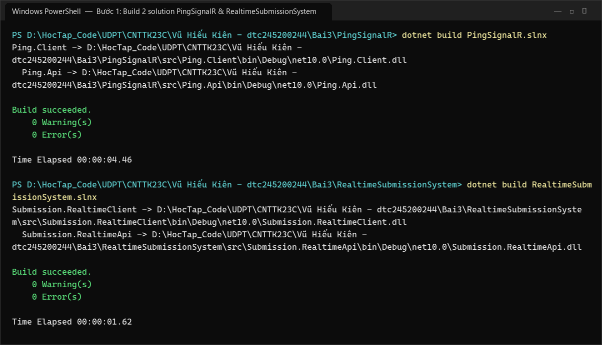
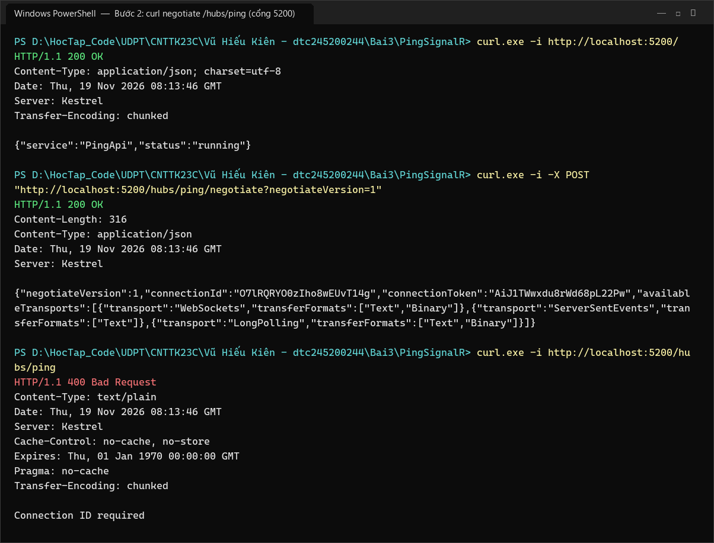
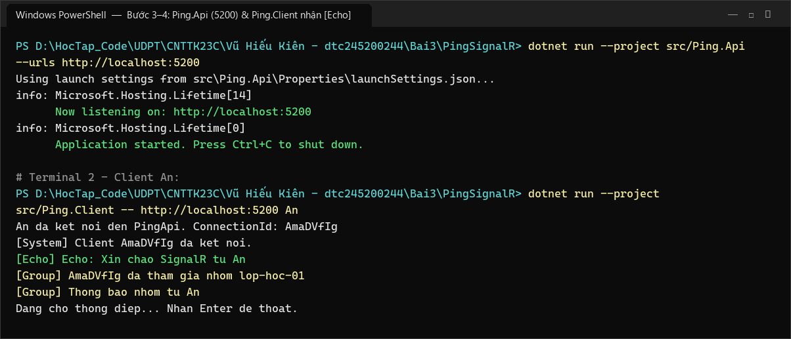
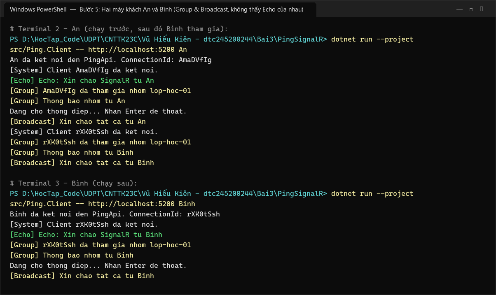
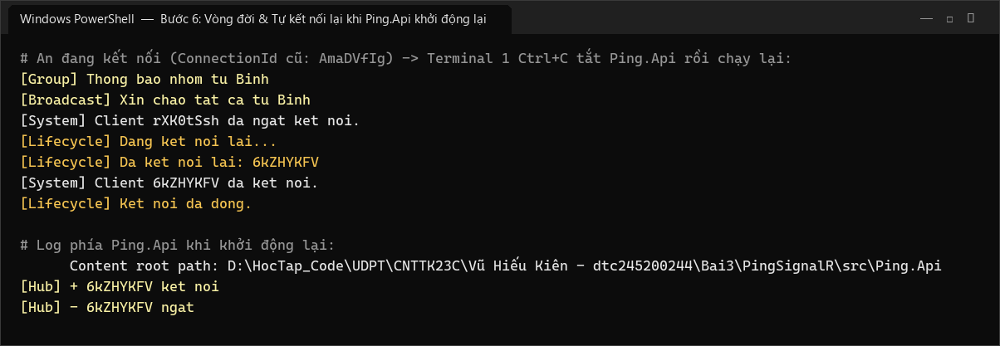
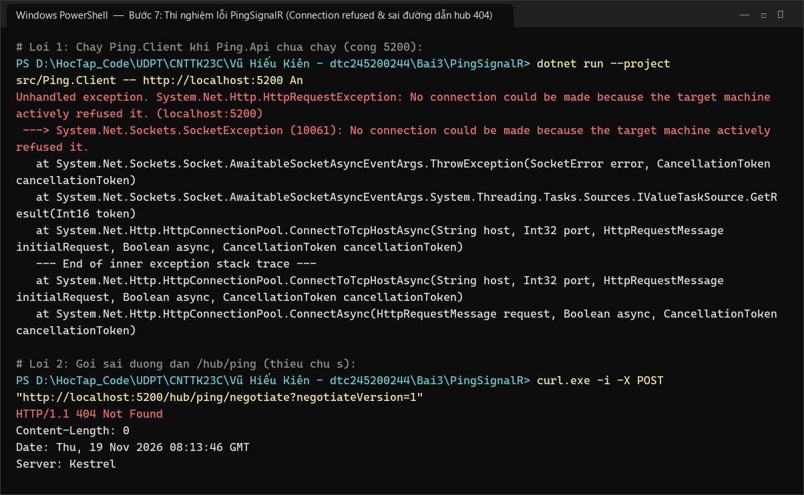
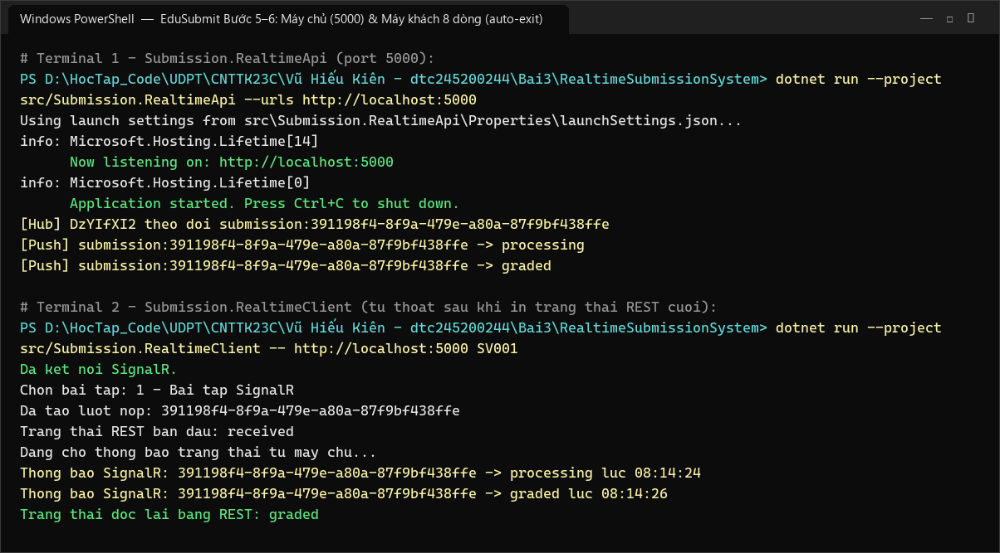
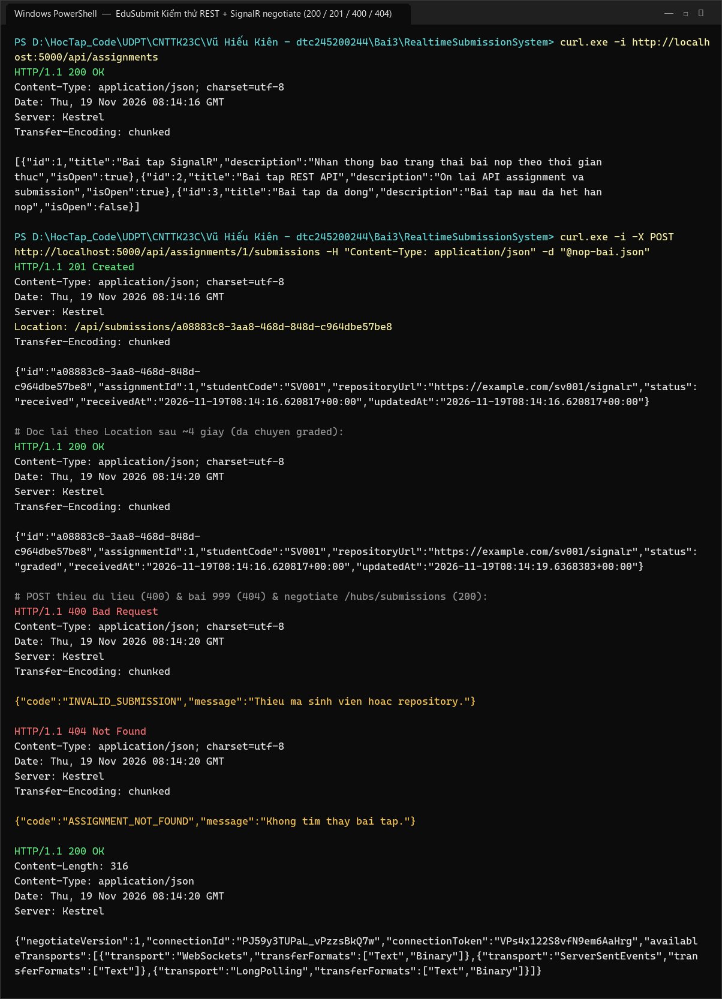
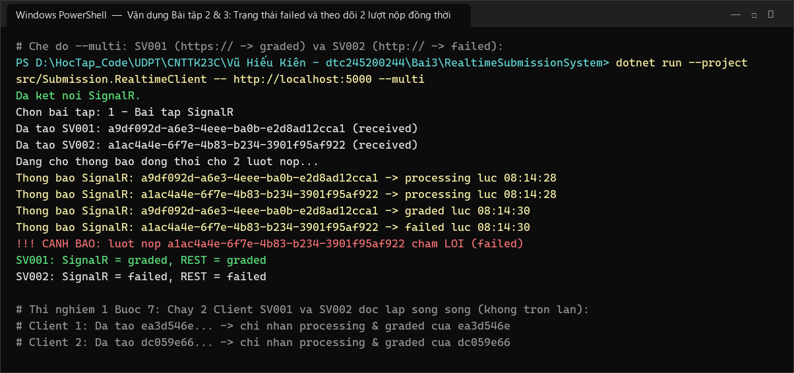
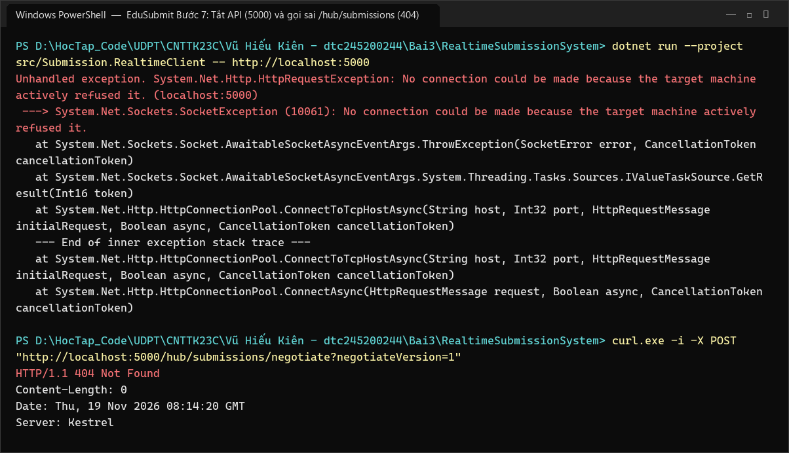

# Bài 3: Giao tiếp thời gian thực với SignalR (`PingSignalR` & `EduSubmit Realtime`)

- **Họ và tên:** Vũ Hiếu Kiên
- **Mã sinh viên:** `dtc245200244`
- **Lớp:** CNTT K23C
- **Học phần:** Phát triển ứng dụng phân tán
- **Môi trường:** Windows 11 | .NET SDK `10.0.201` | `Microsoft.AspNetCore.SignalR.Client` `10.0.15`

---

## 1. Cấu trúc thư mục `Bai3/`

```text
Bai3/
├── README.md                                  # Nhật ký thực hành, ảnh, bảng thí nghiệm & trả lời câu hỏi
├── anh/                                       # Ảnh kết quả chạy thực tế từng bước
│   ├── buoc1-build.png
│   ├── buoc2-negotiate.png
│   ├── buoc4-echo.png
│   ├── buoc5-nhom.png
│   ├── buoc6-noilai.png
│   ├── buoc7-loi.png
│   ├── edusubmit-client.png
│   ├── edusubmit-curl-requests.png
│   ├── edusubmit-baitap2-3.png
│   └── edusubmit-loi-ket-noi.png
├── PingSignalR/                               # Phần 2: Thực hành mẫu SignalR (cổng 5200)
│   ├── .gitignore
│   ├── PingSignalR.slnx
│   └── src/
│       ├── Ping.Api/Program.cs                # Hub /hubs/ping: Echo, Broadcast, JoinGroup, SendToGroup, Lifecycle
│       └── Ping.Client/Program.cs             # HubConnectionBuilder + WithAutomaticReconnect + On<string>
└── RealtimeSubmissionSystem/                  # Phần 3: EduSubmit kết hợp REST + SignalR (cổng 5000)
    ├── .gitignore
    ├── RealtimeSubmissionSystem.slnx
    ├── requests.http                          # 12 ca kiểm thử REST (200, 201, 400, 404) & negotiate hub
    ├── nop-bai.json                           # Dữ liệu JSON mẫu kiểm thử POST
    └── src/
        ├── Submission.RealtimeApi/Program.cs  # REST Bài 2 + UpdatedAt + lock + SubmissionHub + IHubContext + failed
        └── Submission.RealtimeClient/Program.cs # Kênh REST + SignalR (hỗ trợ cả đơn và --multi cho Bài tập 2 & 3)
```

---

## 2. Phần 2 — `PingSignalR` (Cổng `5200`)

### Bước 1: Tạo solution, cài gói `Microsoft.AspNetCore.SignalR.Client 10.0.15` và build

```powershell
dotnet build PingSignalR.slnx
# Build succeeded. 0 Warning(s), 0 Error(s)
```



### Bước 2: Đăng ký `AddSignalR()`, ánh xạ `/hubs/ping` và gọi `negotiate`

```powershell
# Terminal 1:
dotnet run --project src/Ping.Api --urls http://localhost:5200

# Terminal 2:
curl.exe -i http://localhost:5200/
curl.exe -i -X POST "http://localhost:5200/hubs/ping/negotiate?negotiateVersion=1"
curl.exe -i http://localhost:5200/hubs/ping
```
- **Thấy:** `negotiate` trả về `200 OK` kèm `connectionId` và `availableTransports` gồm `WebSockets`, `ServerSentEvents`, `LongPolling`; gọi `GET /hubs/ping` trực tiếp trả `400 Connection ID required`.



### Bước 3–4: `PingHub.Echo` (`Clients.Caller`) và `Ping.Client` nhận `[Echo]`

```powershell
dotnet run --project src/Ping.Client -- http://localhost:5200 An
# An da ket noi den PingApi. ConnectionId: AmaDVfIg
# [Echo] Echo: Xin chao SignalR tu An
```



### Bước 5: Nhóm (`JoinGroup`, `SendToGroup`) và Phát rộng (`Broadcast`) trên 2 máy khách

- Chạy `An` trước, `Binh` sau trên 2 terminal:
  - `An` nhận được `[Group]` và `[Broadcast]` của cả `An` và `Binh` (cùng `[System]`), **không** nhận `[Echo]` của `Binh` vì `Clients.Caller` chỉ trả cho đúng kết nối vừa gọi.
  - `Binh` chỉ nhận tin phát từ thời điểm `Binh` kết nối trở đi.



### Bước 6: Vòng đời kết nối (`OnConnectedAsync`, `OnDisconnectedAsync`) & `WithAutomaticReconnect`

- Khi `An` đang giữ kết nối (`ConnectionId: AmaDVfIg`), tắt `Ping.Api` rồi chạy lại:
  - `An` tự động kích hoạt `Reconnecting` (`[Lifecycle] Dang ket noi lai...`) và nối lại thành công (`[Lifecycle] Da ket noi lai: 6kZHYKFV`).
  - `ConnectionId` thay đổi (`AmaDVfIg` $\rightarrow$ `6kZHYKFV`) vì máy chủ coi đây là một kết nối mới.



### Bước 7: Bảng 3 thí nghiệm lỗi `PingSignalR`

| # | Thí nghiệm | Dự đoán | Kết quả thật | Giải thích |
| :-: | :--- | :--- | :--- | :--- |
| 1 | Chạy `Ping.Client` khi `Ping.Api` chưa chạy | Lỗi kết nối TCP tới cổng `5200` | `HttpRequestException: No connection could be made because the target machine actively refused it. (localhost:5200)` | `StartAsync()` ném ngoại lệ ngay; `WithAutomaticReconnect()` chỉ tự thử lại cho kết nối **đã mở** trước đó. |
| 2 | Gọi sai đường dẫn `/hub/ping` (thiếu chữ `s`) | `404 Not Found` ngay ở bước `negotiate` | `HTTP/1.1 404 Not Found` (`Content-Length: 0`) | `WithUrl` phải khớp chính xác chuỗi trong `app.MapHub<PingHub>("/hubs/ping")`. |
| 3 | Sửa sai tên chiều xuống `On("EchoRespone")` (thiếu `s`) hoặc chiều lên `InvokeAsync("Ech0")` | Chiều xuống: im lặng không in gì; chiều lên: `HubException` | Chiều xuống không có lỗi biên dịch nhưng bỏ qua thông điệp; chiều lên báo `HubException: Method does not exist` | Hợp đồng SignalR dựa vào **tên phương thức / tên sự kiện dạng chuỗi**. Sai tên chiều xuống là lỗi im lặng nên phải đối chiếu khớp từng ký tự ở cả hai phía. |



---

## 3. Phần 3 — `EduSubmit Realtime` (`RealtimeSubmissionSystem`, Cổng `5000`)

### 3.1. Khung 4 câu hỏi thiết kế kênh thời gian thực (Slide 17 & 46)

1. **Sự kiện nào?** Mỗi khi trạng thái lượt nộp chuyển (`received` $\rightarrow$ `processing` $\rightarrow$ `graded` / `failed`) trong `UpdateStatusAsync`.
2. **Gửi cho ai?** `Clients.Group(SubmissionGroups.ForSubmission(id))` (nhóm `submission:{id}`), để bảo mật riêng tư (SV khác không thấy) và tiết kiệm băng thông.
3. **Gửi kèm dữ liệu gì?** Dữ liệu tối thiểu: `record SubmissionStatusMessage(Guid SubmissionId, string Status, DateTimeOffset UpdatedAt)`.
4. **Mất kết nối thì sao?** SignalR không lưu tin đã trôi qua; máy khách đọc lại nguồn sự thật qua REST `GET /api/submissions/{id}`.

### 3.2. Kết quả chạy `Submission.RealtimeApi` & `Submission.RealtimeClient` (8 dòng)

```powershell
# Terminal 1:
dotnet run --project src/Submission.RealtimeApi --urls http://localhost:5000

# Terminal 2:
dotnet run --project src/Submission.RealtimeClient -- http://localhost:5000 SV001
```
Kết quả thực tế trên Terminal 2 (client tự thoát sau khi chốt lại trạng thái REST cuối):
```text
Da ket noi SignalR.
Chon bai tap: 1 - Bai tap SignalR
Da tao luot nop: 391198f4-8f9a-479e-a80a-87f9bf438ffe
Trang thai REST ban dau: received
Dang cho thong bao trang thai tu may chu...
Thong bao SignalR: 391198f4-8f9a-479e-a80a-87f9bf438ffe -> processing luc 08:14:24
Thong bao SignalR: 391198f4-8f9a-479e-a80a-87f9bf438ffe -> graded luc 08:14:26
Trang thai doc lai bang REST: graded
```



### 3.3. Kiểm thử REST + `negotiate` (`requests.http` — 12 ca)

- `requests.http` gồm **12 request** bao phủ `200`, `201`, `400`, `404`, `POST /hubs/submissions/negotiate?negotiateVersion=1` (`200 + connectionId`), `POST /hub/submissions/negotiate` (`404`), và ca mở rộng `http://` $\rightarrow$ `failed`.



### 3.4. Vận dụng Bài tập 2 & 3: Trạng thái `failed` và theo dõi 2 lượt nộp đồng thời

- Server (`SimulateGradingAsync`): nếu `RepositoryUrl` không bắt đầu bằng `https://`, trạng thái cuối chuyển thành `failed`.
- Client (`--multi`, dùng `ConcurrentDictionary<Guid, TaskCompletionSource<string>>`): tạo đồng thời `SV001` (`https://example.com/sv001/signalr`) và `SV002` (`http://example.com/sv002/signalr`), gọi `WatchSubmission` cho cả hai trên cùng một kết nối:
  ```text
  Da tao SV001: a9df092d-a6e3-4eee-ba0b-e2d8ad12cca1 (received)
  Da tao SV002: a1ac4a4e-6f7e-4b83-b234-3901f95af922 (received)
  Thong bao SignalR: a9df092d-... -> processing
  Thong bao SignalR: a1ac4a4e-... -> processing
  Thong bao SignalR: a9df092d-... -> graded
  Thong bao SignalR: a1ac4a4e-... -> failed
  !!! CANH BAO: luot nop a1ac4a4e-... cham LOI (failed)
  SV001: SignalR = graded, REST = graded
  SV002: SignalR = failed, REST = failed
  ```



### 3.5. Bảng 5 thí nghiệm phân tán EduSubmit (Bước 7 — Slide 58–59)

| # | Thí nghiệm | Dự đoán (trước khi chạy) | Kết quả thật quan sát được | Giải thích / Bài học phân tán |
| :-: | :--- | :--- | :--- | :--- |
| **1** | Chạy 2 máy khách `SV001` và `SV002` song song | Mỗi máy khách chỉ thấy lượt nộp của chính mình | Client 1 tạo `ea3d546e...` và chỉ nhận push của `ea3d546e`; Client 2 tạo `dc059e66...` và chỉ nhận push của `dc059e66`. | Nhóm `submission:{id}` trên server cô lập thông điệp theo từng lượt nộp, không lẫn giữa hai tiến trình. |
| **2** | Chạy `Submission.RealtimeClient` khi `Submission.RealtimeApi` chưa chạy | Client báo lỗi từ chối kết nối ở cổng `5000` | `HttpRequestException: No connection could be made because the target machine actively refused it. (localhost:5000)` tại `StartAsync()`. | `WithAutomaticReconnect()` chỉ cứu kết nối **đã thiết lập**; lần nối đầu thất bại ném lỗi ngay. |
| **3** | Gọi sai đường dẫn `/hub/submissions` (thiếu `s`) | Bước `negotiate` bị `404 Not Found` | `POST .../hub/submissions/negotiate?negotiateVersion=1` trả `HTTP/1.1 404 Not Found` (`Content-Length: 0`). | Phải khớp chính xác route `/hubs/submissions` của `MapHub<SubmissionHub>`. |
| **4** | Đổi sai tên sự kiện `On("SubmissionStatusChange")` (thiếu `d`) | Không lỗi biên dịch, hết 10s hết giờ chờ rồi REST đọc được `graded` | Client không nhận được dòng `Thong bao SignalR:`, in thông báo hết giờ chờ (`10s`) rồi `GET` REST trả `graded`. | Tên sự kiện ở `SendAsync` và `On` phải khớp tuyệt đối từng ký tự; sai tên chiều xuống thì im lặng. |
| **5** | Chờ 4 giây sau `POST` rồi mới gọi `WatchSubmission` (hoặc nhận sau khi chấm xong) | Không nhận được tin `processing`/`graded` qua SignalR; REST vẫn trả `graded` | Trong 3 giây đầu server đã đẩy xong trước khi vào nhóm nên không nhận thêm tin push nào; gọi `GET /api/submissions/{id}` vẫn trả `"status": "graded"`. | Vào nhóm muộn hoặc rớt mạng sẽ lỡ thông điệp đẩy $\rightarrow$ luôn dùng REST làm **nguồn sự thật**. |



---

## 4. Trả lời 3 câu hỏi đầu giờ (Slide 3 & Slide 65) & Tóm tắt ôn tập

### Câu 1: Máy chủ có thể chủ động báo cho máy khách mà không cần máy khách hỏi không?
- **Có**, nếu máy khách mở sẵn một **kết nối lâu dài hai chiều** (WebSocket, hoặc SSE/Long Polling dự phòng do thư viện **SignalR** tự thương lượng ở bước `negotiate`).
- Trong code đã viết: `PingHub` gọi `Clients.Caller` / `Clients.All` / `Clients.Group(...).SendAsync(...)`, còn `Submission.RealtimeApi` khi đứng **bên ngoài hub** (trong tác vụ nền `SimulateGradingAsync` / `UpdateStatusAsync`) tiêm **`IHubContext<SubmissionHub>`** để đẩy `"SubmissionStatusChanged"` tới đúng nhóm `submission:{id}` mà không cần máy khách hỏi lại.

### Câu 2: Đã có REST rồi, vì sao còn cần thêm SignalR? Hai thứ chia việc thế nào?
- Trong giao tiếp HTTP/REST thông thường, chỉ máy khách được mở lời (`request -> response`). Nếu muốn biết khi nào bài chấm xong mà chỉ dùng REST, máy khách phải **polling** định kỳ (`GET` lặp lại mỗi 2s), gây lãng phí rất nhiều request thừa hoặc bị trễ.
- Vì vậy **SignalR không thay thế REST** mà hai cơ chế chia việc bổ sung cho nhau:
  - **REST (`Bài 2` + `Bài 3`)** chịu trách nhiệm thao tác tài nguyên có kết quả trực tiếp (`GET /api/assignments`, `POST /api/assignments/{id}/submissions` $\rightarrow$ `201 Created`) và đóng vai trò **nguồn sự thật** (`GET /api/submissions/{id}`).
  - **SignalR (`Bài 3`)** chịu trách nhiệm đẩy tức thời các thay đổi phát sinh sau yêu cầu ban đầu (`processing`, `graded`, `failed`) từ máy chủ về đúng nhóm theo dõi.

### Câu 3: Nếu đứt mạng đúng lúc máy chủ báo "đã chấm xong" (`graded`) thì sao?
- SignalR không lưu đệm tin nhắn cho kết nối bị đứt: thông điệp đẩy đúng lúc mất kết nối sẽ **bị mất**.
- Khi mạng có lại, `WithAutomaticReconnect()` tự nối lại theo lịch mặc định (`0s, 2s, 10s, 30s`) với một **`ConnectionId` mới** (nên nhóm cũ gắn với `ConnectionId` cũ cũng mất).
- Vì thế trong `Submission.RealtimeClient`: trong sự kiện `Reconnected` cần gọi lại `WatchSubmission` để vào lại nhóm, và quan trọng nhất là **luôn gọi lại REST `GET /api/submissions/{id}`** để lấy trạng thái cuối cùng chính xác (**"Push để nhanh, REST để chắc"**).

### Ghi chú ôn tập Chương 3 (Slide 68):
- **3 MEP:** Request–Response (client khởi tạo, 1-1), Push (server khởi tạo khi có sự kiện, thông điệp lẻ), Streaming (chuỗi nhiều thông điệp liên tục như log/% tiến độ).
- **WebSocket vs SignalR:** WebSocket là giao thức; SignalR là thư viện cấp cao cung cấp Hub, Group, tái kết nối, và thứ tự truyền tải dự phòng: `WebSockets` $\rightarrow$ `ServerSentEvents` $\rightarrow$ `LongPolling`.
- **Mở rộng nhiều bản sao server (Scale-out):** Nhóm trong RAM của một instance không chia sẻ sang instance khác $\rightarrow$ phải cấu hình backplane chung (ví dụ Redis backplane hoặc Azure SignalR Service).
