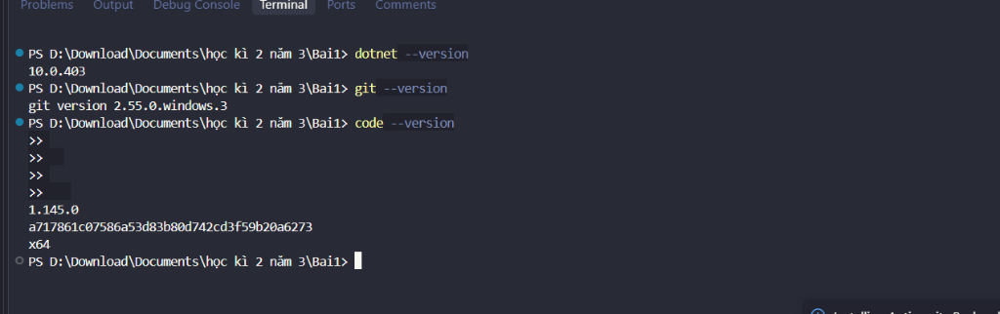
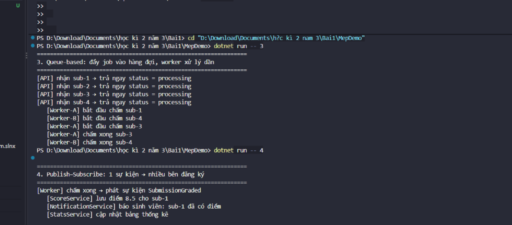
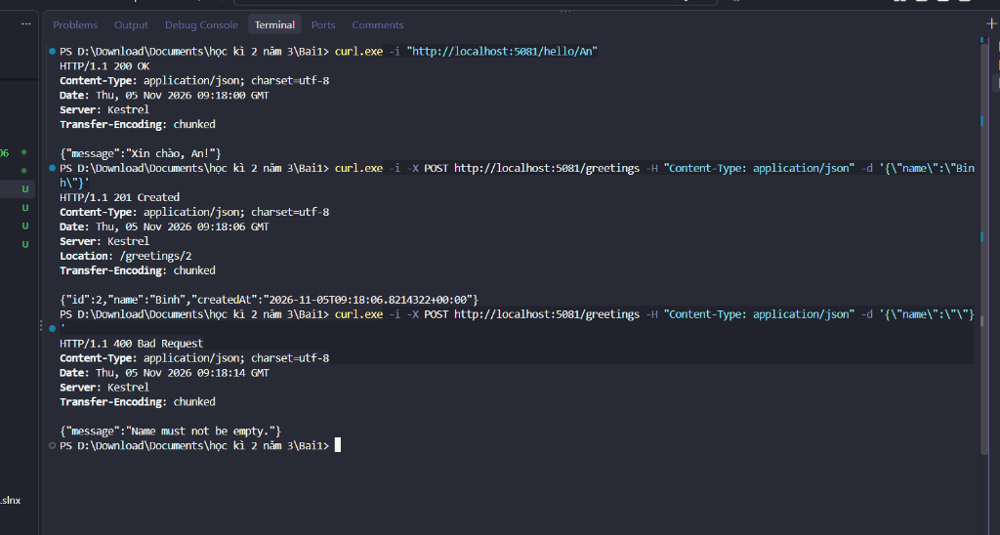
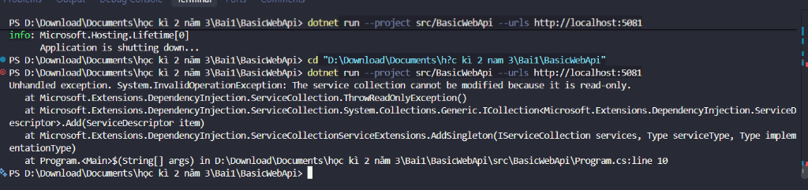
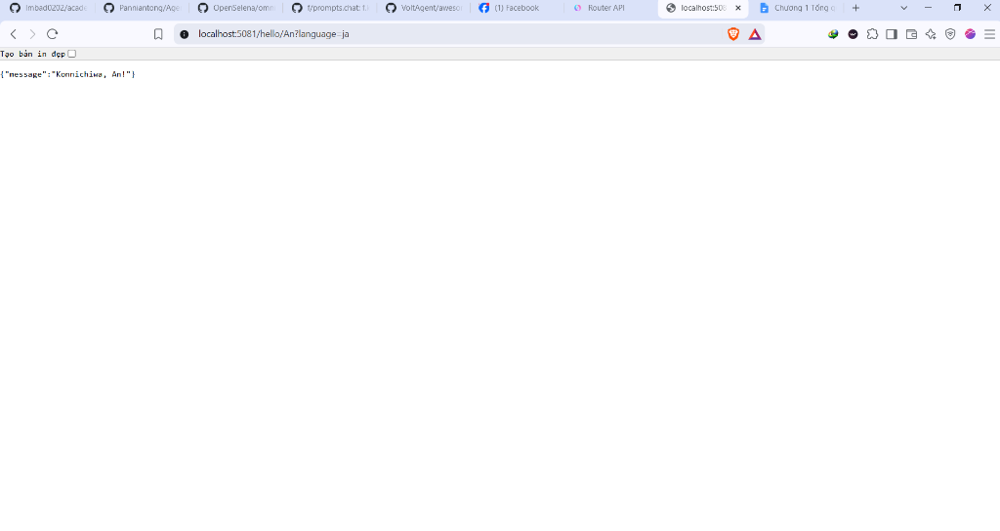
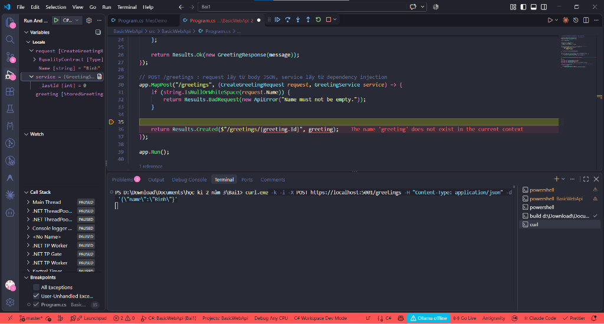
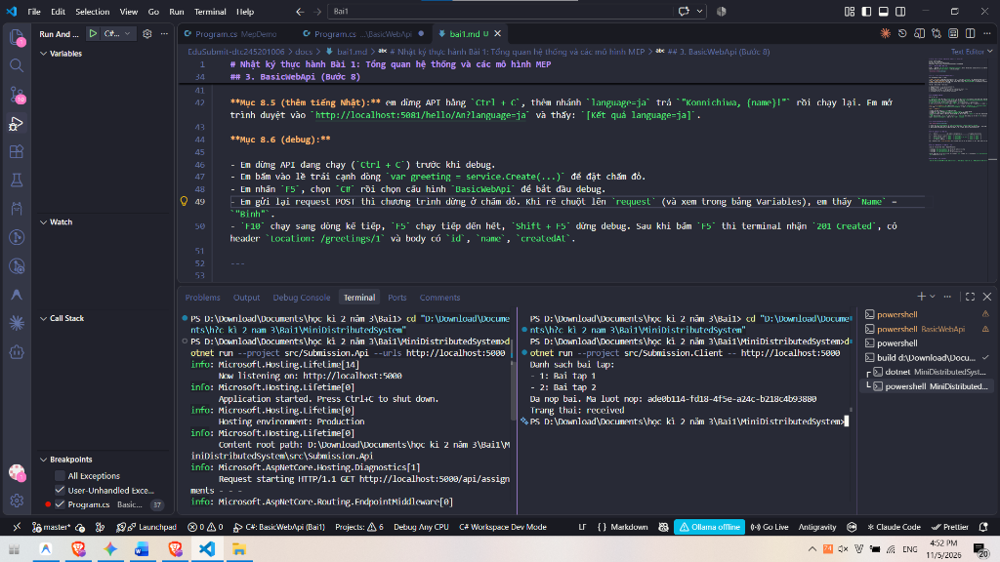
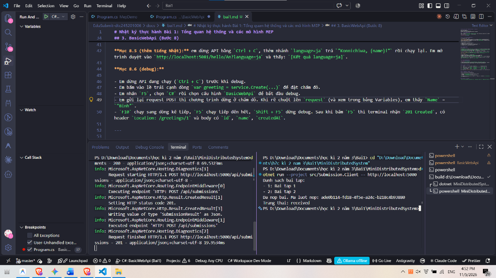
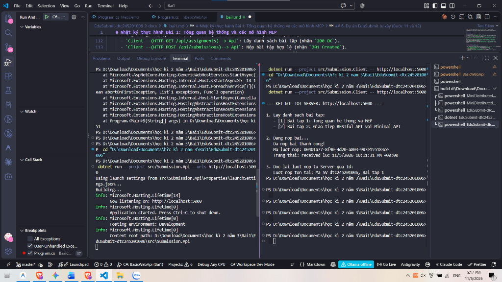

# Nhật ký thực hành Bài 1: Tổng quan hệ thống và các mô hình MEP

Họ tên: Đinh Bách Hợp  
Mã sinh viên: DTC245201006  
Học phần: Phát triển ứng dụng phân tán  
Repository: https://github.com/minesan2297/EduSubmit-dtc245201006  

---

## 1. Cài đặt môi trường (Bước 4)

Em cài đặt .NET SDK, Git và VS Code theo hướng dẫn. Kết quả kiểm tra phiên bản:

- `dotnet --version` → 10.0.403
- `git --version` → 2.55.0
- `code --version` → đã cài extension C# Dev Kit và REST Client



---

## 2. Thử các mô hình MEP bằng MepDemo (Bước 7)

Em chạy MepDemo và quan sát 2 mô hình:



Kết quả quan sát:

- **MEP 3 (hàng đợi):** API nhận 4 bài nộp `sub-1` đến `sub-4` cùng lúc, trả về trạng thái `processing`. Worker-A chấm `sub-1`, `sub-3`; Worker-B chấm `sub-4`, `sub-2`. Mỗi bài chỉ có 1 worker chấm, không bị chấm trùng.
- **MEP 4 (pub-sub):** Khi worker chấm xong, phát sự kiện `SubmissionGraded`. Cả 3 service là `ScoreService`, `NotificationService`, `StatsService` đều nhận được sự kiện đó cùng lúc.

Tóm tắt 5 mô hình MEP:

1. **Request-Response:** Client gửi yêu cầu, chờ server trả về rồi mới tiếp tục.
2. **One-Way:** Client gửi xong là chạy tiếp, không cần chờ phản hồi.
3. **Queue-Based:** Tin nhắn được đẩy vào hàng đợi, các worker lấy ra xử lý dần.
4. **Publish-Subscribe:** Bên gửi phát sự kiện lên 1 kênh, tất cả bên đăng ký đều nhận được.
5. **Streaming:** Kết nối mở liên tục, dữ liệu được truyền theo luồng.

---

## 3. BasicWebApi (Bước 8)

Em chạy project `BasicWebApi` và thử nghiệm bằng `curl.exe`:



### Mục 8.4 — Trả lời câu hỏi:

1. `AddSingleton` phải đặt **trước** `builder.Build()` vì sau khi `Build()` chạy xong thì container dịch vụ bị khóa, không thêm được nữa. Em thử đảo lại thì chương trình báo lỗi ngay khi khởi động:

   `System.InvalidOperationException: The service collection cannot be modified because it is read-only.`

   

2. Trong `/hello/{name}?language=en`:
   - `name` lấy từ **route** (nằm trong đường dẫn URL).
   - `language` lấy từ **query string** (phần sau dấu `?`).

3. POST trả `201 Created` thay vì `200 OK` vì theo RESTful, `201` có nghĩa là tạo mới thành công. Kèm theo đó có header `Location` chỉ đường dẫn đến tài nguyên vừa tạo (ví dụ `/greetings/1`).

### Mục 8.5 — Thêm tiếng Nhật:

Em thêm nhánh `"ja" => $"Konnichiwa, {name}!"` vào `switch` trong `Program.cs`, khởi động lại rồi mở trình duyệt tại `http://localhost:5081/hello/An?language=ja`:

```json
{"message":"Konnichiwa, An!"}
```



### Mục 8.6 — Debug từng bước:

- Dừng API (`Ctrl + C`), đặt breakpoint ở dòng `var greeting = service.Create(request.Name.Trim());`.
- Nhấn `F5`, chọn cấu hình `C#: BasicWebApi Bai1`.
- Từ terminal khác gửi POST:  
  `curl.exe -k -i -X POST https://localhost:5001/greetings -H "Content-Type: application/json" -d '{\"name\":\"Binh\"}'`
- Chương trình dừng đúng tại breakpoint, kiểm tra thấy `request.Name = "Binh"` trong tab Variables.
- Nhấn `F10` qua dòng tiếp theo thấy `greeting.Id = 1`, nhấn `F5` cho chạy tiếp thì nhận được `201 Created`. Nhấn `Shift + F5` để thoát debug.



---

## 4. MiniDistributedSystem (Bước 9)

Em chạy 2 terminal song song: Terminal 1 chạy API, Terminal 2 chạy Client.





Trả lời câu hỏi:

1. Client gọi 2 endpoint:
   - `GET /api/assignments` → nhận `200 OK` (danh sách bài tập).
   - `POST /api/submissions` → nhận `201 Created` (nộp bài thành công).

2. Client không dùng chung code với API. Hai bên chỉ cần thống nhất về URL, HTTP method, cấu trúc JSON và mã trạng thái — gọi là Contract (hợp đồng).

3. Địa chỉ API truyền qua tham số dòng lệnh (`-- http://localhost:5000`) thay vì viết cứng trong code, để sau này muốn đổi địa chỉ thì chỉ cần thay tham số chứ không cần sửa code.

---

## 5. Thí nghiệm gây lỗi (Bước 10)

| # | Thao tác | Dự đoán | Kết quả thực tế | Đúng/Sai | Giải thích |
|---|---|---|---|---|---|
| a | Thêm bài tập thứ 3 vào mảng `assignments` ở API, chạy lại Client | Client tự hiển thị 3 bài | Client in đủ 3 bài mà không sửa code | Đúng | Client đọc mảng JSON từ API rồi duyệt vòng lặp, nên thêm phần tử là in thêm ngay. |
| b | Tắt API rồi chạy Client | Client báo lỗi kết nối | `HttpRequestException: ...actively refused it. (localhost:5000)` | Đúng | Khác với gọi hàm trong cùng process, kết nối mạng cần server đang chạy mới thành công. |
| c | Đổi `StudentCode` thành chuỗi rỗng `""` | Server từ chối, báo 400 | In được danh sách bài, sau đó lỗi `400 (Bad Request)` tại `EnsureSuccessStatusCode()` | Đúng | Server phải tự validate dữ liệu đầu vào. Client ném exception khi nhận mã ngoài 2xx. |
| d | Đổi API sang cổng 5050, Client vẫn gọi 5000 | Lỗi kết nối sai cổng | Báo lỗi refused. Chạy lại với `-- http://localhost:5050` thì OK | Đúng | Vì địa chỉ đọc từ `args[0]` nên chỉ cần sửa tham số là được. |

---

## 6. Dự án EduSubmit tự xây (Bước 11 và 12)



Em tạo Solution `EduSubmit` gồm 2 project: `Submission.Api` (Minimal API) và `Submission.Client` (Console app).

Luồng hoạt động:
- Client gọi `GET /api/assignments` → lấy danh sách bài tập.
- Client gọi `POST /api/submissions` → nộp bài, nhận về ID của lượt nộp.
- Client gọi `GET /api/submissions/{id}` → đọc lại thông tin lượt nộp vừa tạo.

Phần mở rộng (Bước 12): API lưu danh sách lượt nộp trong RAM (`List<SubmissionResult>`). Endpoint `GET /api/submissions/{id:guid}` trả `200 OK` nếu tìm thấy, `404 Not Found` nếu không có. Client dùng ID nhận được sau khi POST để gọi lại và xác nhận.

Khi làm em có tham khảo cấu trúc DTO và cách dùng `EnsureSuccessStatusCode()` từ phần MiniDistributedSystem mẫu.

---

## 7. Khó khăn và cách giải quyết

1. **curl trên PowerShell bị lỗi JSON:** Dấu `\"` trong PowerShell hay bị parse sai nên server nhận body rỗng, trả `400`. Giải quyết bằng cách bọc toàn bộ chuỗi JSON trong dấu nháy đơn `'...'`.

2. **Debug chạy ở HTTPS cổng 5001:** Khi nhấn F5 thì API bật HTTPS, curl thường báo lỗi chứng chỉ. Thêm `-k` vào lệnh curl để bỏ qua xác thực chứng chỉ dev.

3. **Lỗi `AddSingleton` sau `Build()`:** Lúc đầu em để nhầm vị trí nên chương trình crash ngay khi khởi động. Sửa lại bằng cách chuyển lên trước `builder.Build()` là hết lỗi.
