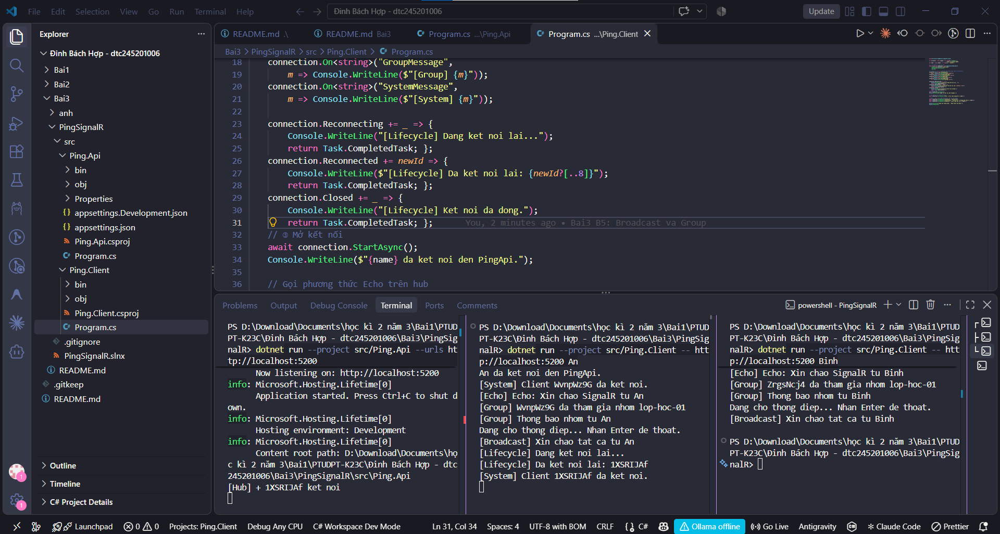
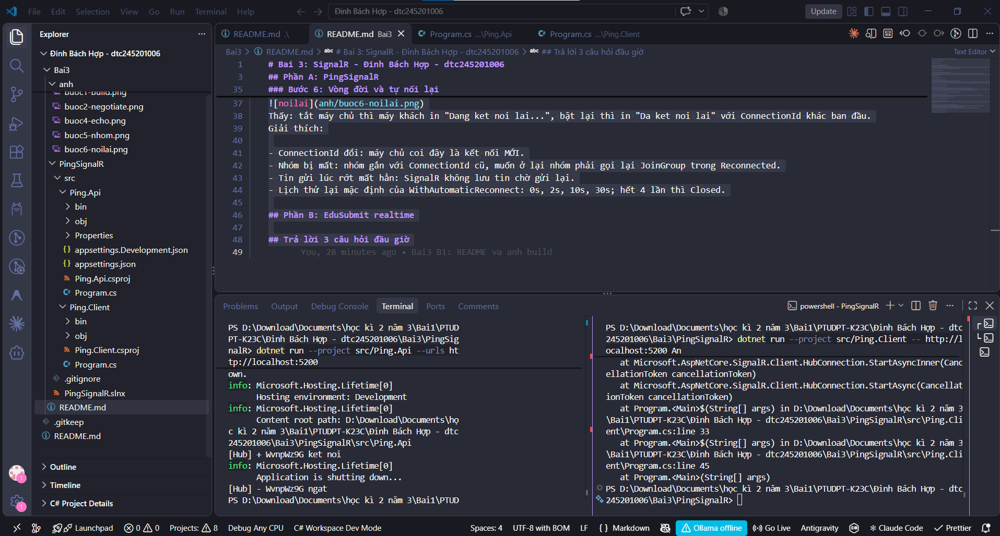
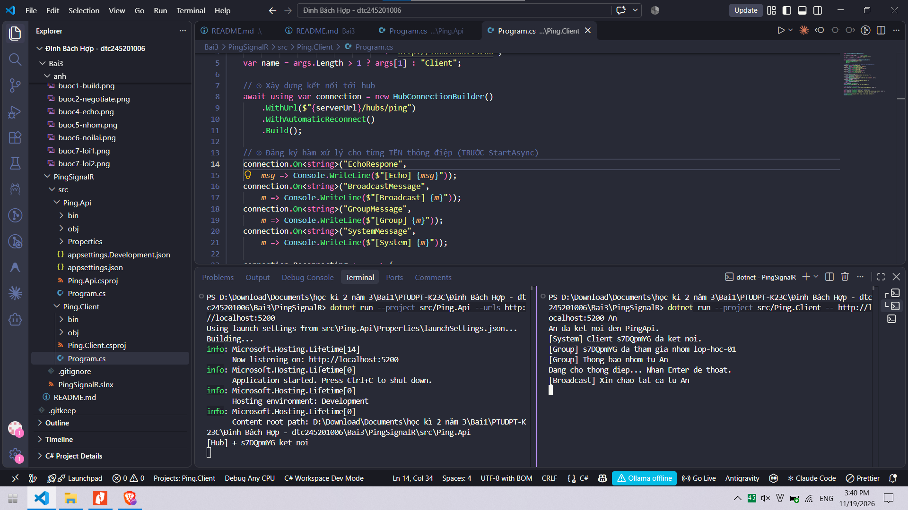
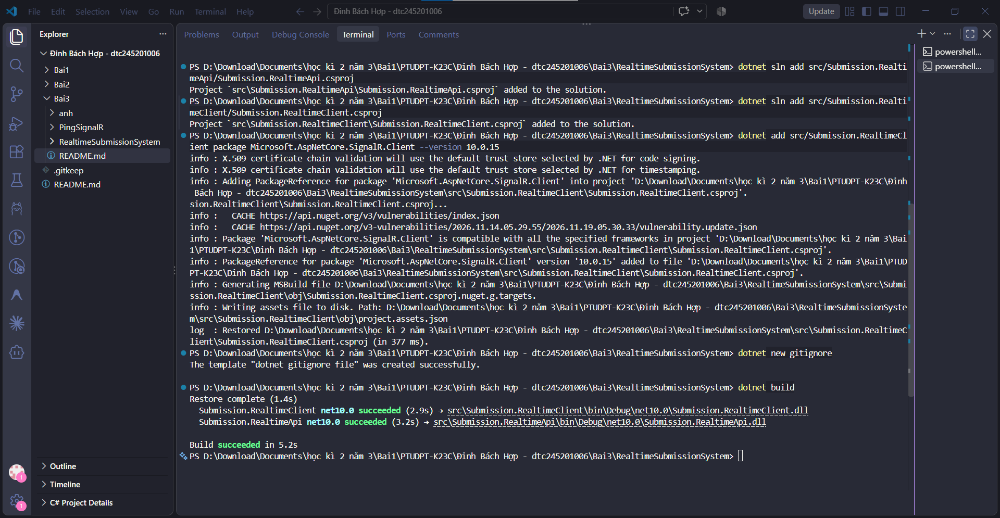
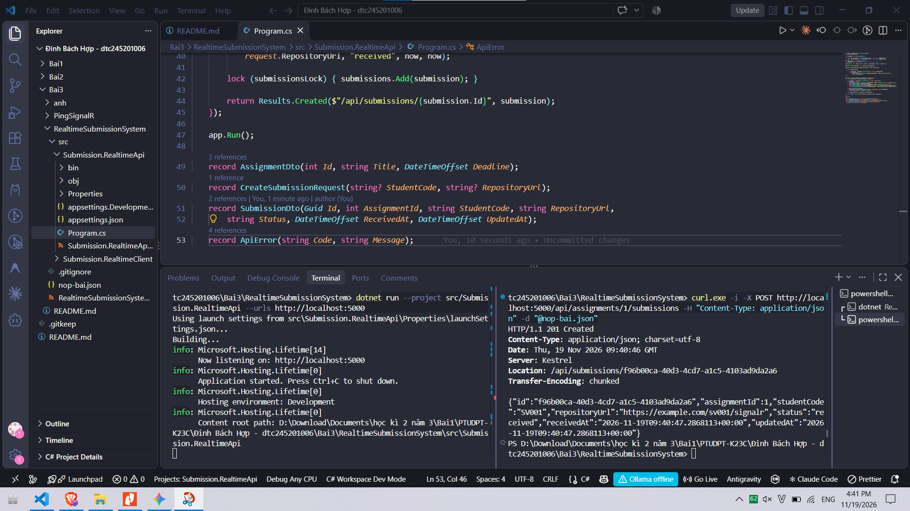
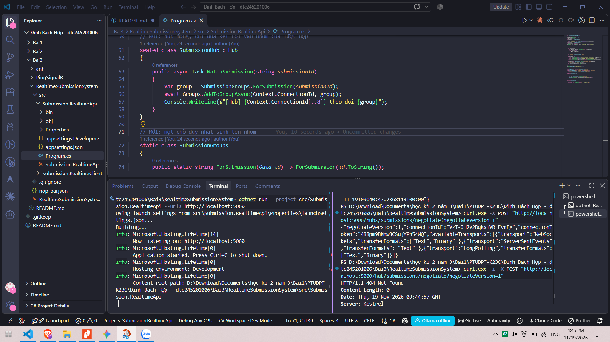
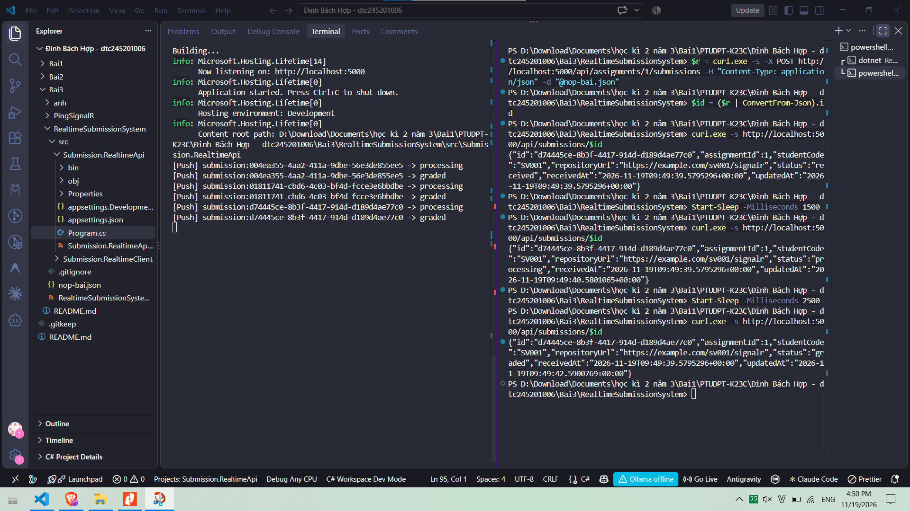
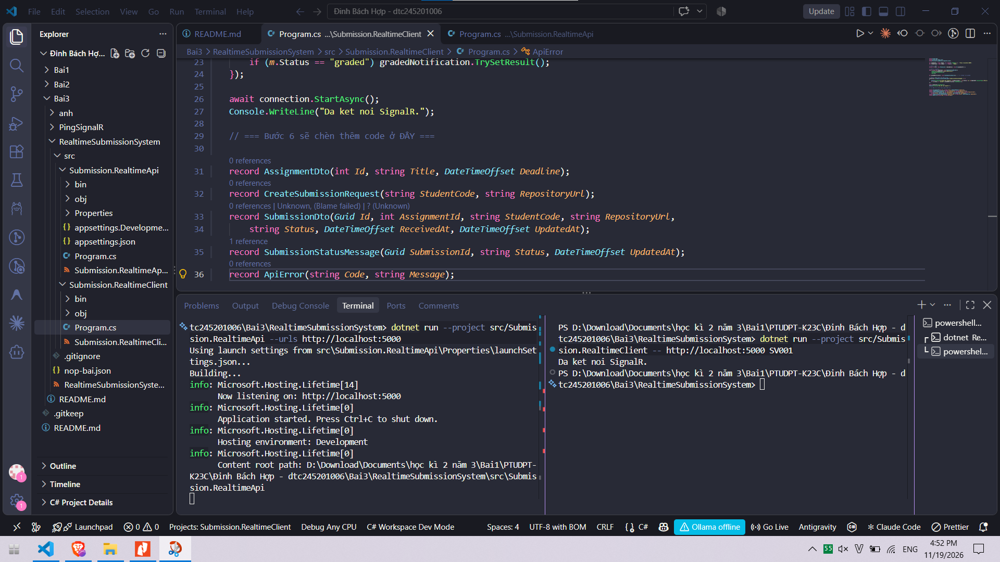
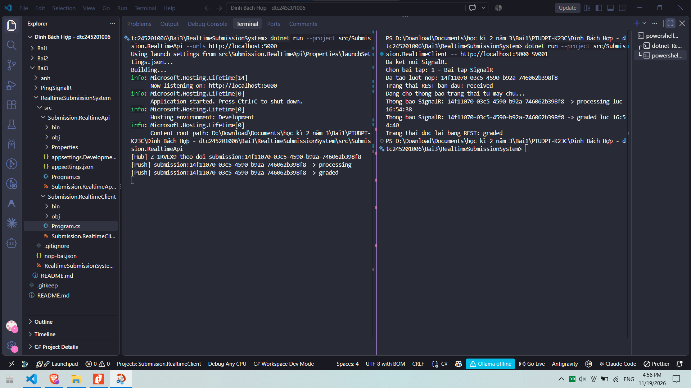

# Bai 3: SignalR - Đinh Bách Hợp - dtc245201006

## Phần A: PingSignalR

### Bước 1: build

Thấy: Build succeeded, không có lỗi.
Giải thích: tạo solution gồm 2 project (máy chủ Ping.Api, máy khách Ping.Client), thêm gói SignalR.Client cho máy khách. Máy chủ không cần thêm gói vì ASP.NET Core đã có sẵn SignalR.

### Bước 2: negotiate

Thấy: curl trả về connectionId và availableTransports gồm WebSockets, ServerSentEvents, LongPolling.
Giải thích: máy chủ báo các cách truyền tải SignalR có thể dùng; GET trực tiếp vào hub trả 400 vì hub cần ConnectionId, không trả lời như REST.

### Bước 3-4: Echo

Thấy: máy khách in [Echo] Echo: Xin chao SignalR tu An.
Giải thích: máy khách gọi InvokeAsync("Echo"), hub trả lời riêng người gọi bằng Clients.Caller.SendAsync("EchoResponse"); hàm On("EchoResponse") in ra. Tên phải khớp từng chữ: sai tên InvokeAsync thì báo HubException, sai tên On thì im lặng.

### Bước 5: Broadcast và Group

Thấy: An nhận [Group] và [Broadcast] của Bình nhưng không nhận [Echo] của Bình.
Giải thích: Echo dùng Clients.Caller nên chỉ gửi người gọi; JoinGroup/SendToGroup dùng Clients.Group nên chỉ thành viên nhóm lop-hoc-01 nhận; Broadcast dùng Clients.All nên mọi kết nối đều nhận, kể cả người gửi.

Thử thách (An, Bình trong nhóm; Chi không ở nhóm nào):

- An gọi Echo("hi"): chỉ An nhận.
- Chi gọi SendToGroup("lop-hoc-01","x"): An và Bình nhận, Chi không nhận vì không phải thành viên.
- Bình gọi Broadcast("y"): cả 3 người nhận.

### Bước 6: Vòng đời và tự nối lại

Thấy: tắt máy chủ thì máy khách in "Dang ket noi lai...", bật lại thì in "Da ket noi lai" với ConnectionId khác ban đầu.
Giải thích:

- ConnectionId đổi: máy chủ coi đây là kết nối MỚI.
- Nhóm bị mất: nhóm gắn với ConnectionId cũ, muốn ở lại nhóm phải gọi lại JoinGroup trong Reconnected.
- Tin gửi lúc rớt mất hẳn: SignalR không lưu tin chờ gửi lại.
- Lịch thử lại mặc định của WithAutomaticReconnect: 0s, 2s, 10s, 30s; hết 4 lần thì Closed.

### Bước 7: Ba thí nghiệm lỗi

#### Lỗi 1: Máy chủ chưa chạy

- Làm gì: tắt máy chủ rồi chạy máy khách.
- Thấy: máy khách dừng với HttpRequestException, không kết nối được tới localhost:5200.
- Giải thích: chưa có tiến trình nào lắng nghe cổng 5200. WithAutomaticReconnect chỉ cứu kết nối ĐÃ mở, không tự thử lại lần nối đầu tiên.

#### Lỗi 2: Sai đường dẫn hub

- Làm gì: sửa WithUrl thành /hub/ping (thiếu chữ s).
- Thấy: HttpRequestException với mã 404 (Not Found).
- Giải thích: lỗi xảy ra ở bước negotiate. Đường dẫn trong WithUrl phải khớp từng chữ với MapHub<PingHub>("/hubs/ping").

#### Lỗi 3: Sai tên thông điệp

- Làm gì: sửa On("EchoResponse") thành On("EchoRespone") (thiếu một chữ s).
- Thấy: không có lỗi nào, nhưng không in dòng [Echo]; các dòng [System], [Group], [Broadcast] vẫn hiện bình thường.
- Giải thích: chiều hub gửi về máy khách chỉ khớp bằng chuỗi tên, nên sai một chữ thì không có lỗi biên dịch, không có lỗi chạy, chỉ là không nhận được gì. Khi "không nhận được gì", việc đầu tiên là so tên hai phía.

## Phần B: EduSubmit realtime

## EduSubmit - Bước 1: tạo solution

Thấy: dotnet build báo Build succeeded, 0 Error(s).
Giải thích: solution có 2 project (máy chủ Submission.RealtimeApi, máy khách Submission.RealtimeClient); build trước khi viết code để chắc môi trường và gói NuGet ổn.

## EduSubmit - Bước 2: REST + UpdatedAt + lock

Thấy: POST trả 201 Created, có header Location, body có status received và updatedAt.
Giải thích: UpdatedAt cho biết lần đổi trạng thái gần nhất; lock tránh hai luồng (HTTP và tác vụ nền) cùng sửa danh sách.

## EduSubmit - Bước 3: SubmissionHub và nhóm submission:{id}

Thấy: negotiate ở /hubs/submissions trả connectionId cùng 3 cách truyền tải; sai đường dẫn /hub/submissions trả 404.
Giải thích: hub chỉ có một việc là đưa kết nối vào nhóm submission:{id}. Nhóm theo lượt nộp giúp riêng tư (SV này không thấy bài SV khác) và tiết kiệm băng thông.

## EduSubmit - Bước 4: IHubContext và mô phỏng chấm bài nền

Thấy: ba lần GET cho trạng thái received → processing → graded, updatedAt tăng dần; máy chủ in [Push] processing và graded.
Giải thích: POST trả 201 ngay rồi tác vụ nền chấm bài (Task.Delay giả lập). Máy chủ lưu dữ liệu trước, đẩy thông báo sau, nên ai đọc REST ngay khi nhận tin cũng thấy đúng. Ngoài hub phải dùng IHubContext để gửi, vì đối tượng hub chỉ sống trong một lời gọi.

## EduSubmit - Bước 5: máy khách mở hai kênh

Thấy: máy khách in "Da ket noi SignalR."
Giải thích: máy khách dùng HttpClient cho REST và HubConnection cho SignalR trên cùng một URL gốc. Phải đăng ký On("SubmissionStatusChanged") trước StartAsync để không lỡ tin; tên thông điệp phải khớp từng chữ với SendAsync ở máy chủ.

## EduSubmit - Bước 6: POST → Watch → chờ → GET

Thấy: máy khách (bên phải) in đủ 8 dòng; hai thông báo SignalR (processing, graded) cách nhau khoảng 2 giây mà máy khách không hề hỏi. Máy chủ (bên trái) in [Hub] theo dõi rồi [Push] processing, graded.
Giải thích: REST tạo lượt nộp (201) và đọc trạng thái cuối; SignalR chỉ báo các thay đổi phát sinh sau đó. Thứ tự phải đúng: On → StartAsync → POST → Watch → GET. Trạng thái cuối luôn lấy lại bằng REST vì tin đẩy có thể bị lỡ.

## EduSubmit - Bước 7: 5 thí nghiệm phân tán

### Thí nghiệm 1: chạy 2 máy khách SV001 và SV002 cùng lúc

**Dự đoán:** mỗi máy khách chỉ nhận thông báo của lượt nộp do chính nó tạo, không thấy của máy kia.

## EduSubmit - Bước 7: 5 thí nghiệm phân tán

### Thí nghiệm 1: chạy 2 máy khách SV001 và SV002 cùng lúc

**Dự đoán:** mỗi máy khách chỉ nhận thông báo của lượt nộp do chính nó tạo, không thấy thông báo của máy kia.

**Kết quả thật:** SV001 tạo lượt nộp 8cb1cadb và chỉ nhận processing, graded của lượt nộp này. SV002 tạo lượt nộp b3f06b91 và chỉ nhận processing, graded của lượt nộp b3f06b91. Hai id khác nhau, thông báo không bị trộn lẫn. Máy chủ ghi hai dòng [Hub] theo dõi hai nhóm submission khác nhau.

**Giải thích:** mỗi máy khách gọi WatchSubmission với id của chính mình nên được thêm vào nhóm submission:{id} riêng. Máy chủ gửi bằng Clients.Group nên chỉ thành viên của nhóm đó nhận được. Nhóm tách người nhận, giữ riêng tư cho từng sinh viên và tiết kiệm đường truyền.

### Thí nghiệm 2: chạy máy khách khi máy chủ chưa chạy

**Dự đoán:** máy khách báo lỗi không kết nối được ngay lúc StartAsync và dừng chương trình, không tự thử lại.

**Kết quả thật:** máy khách ném HttpRequestException, báo Connection refused tại localhost:5000 và dừng ngay.

**Giải thích:** máy chủ chưa chạy nên lần nối đầu tiên (StartAsync) thất bại. WithAutomaticReconnect chỉ cứu được kết nối đã mở rồi mới rớt, không tự thử lại lần nối đầu.

### Thí nghiệm 3: sửa WithUrl thành /hub/submissions (thiếu chữ s)

**Dự đoán:** máy chủ trả 404 Not Found ở bước negotiate nên máy khách báo lỗi ngay khi StartAsync.

**Kết quả thật:** máy khách ném HttpRequestException với mã 404 (Not Found) ngay khi StartAsync, lỗi nằm trong NegotiateAsync.

**Giải thích:** lỗi xảy ra ở bước negotiate vì đường dẫn /hub/submissions không tồn tại trên máy chủ. WithUrl phải khớp chính xác với MapHub là /hubs/submissions.

### Thí nghiệm 4: sửa On("SubmissionStatusChanged") thành On("SubmissionStatusChange")

**Dự đoán:** không có lỗi nào nhưng máy khách không in thông báo SignalR; sau 10 giây báo hết thời gian chờ, rồi REST vẫn đọc ra graded.

**Kết quả thật:** không có lỗi nào và không có dòng "Thong bao SignalR". Sau 10 giây in "Qua thoi gian cho thong bao graded." rồi REST đọc lại ra graded. Máy chủ vẫn in [Push] bình thường.

**Giải thích:** On đăng ký theo tên thông điệp, tên "SubmissionStatusChange" không khớp "SubmissionStatusChanged" ở SendAsync nên máy khách bỏ qua thông điệp mà không báo lỗi. Sai tên chiều máy chủ gửi xuống máy khách thì im lặng, rất khó phát hiện. REST vẫn cho trạng thái đúng.

## Trả lời 3 câu hỏi đầu giờ

1. **Máy chủ có thể chủ động báo cho máy khách không?**
   Có, nếu máy khách mở sẵn một kết nối lâu dài (WebSocket qua SignalR). Khi có sự kiện, máy chủ tự gửi bằng `Clients.Group(...).SendAsync(...)`. Nếu gửi từ ngoài hub (như tác vụ chấm bài nền) thì dùng `IHubContext`.

2. **REST và SignalR chia việc thế nào?**
   REST tạo và đọc tài nguyên, có mã trạng thái rõ ràng (201, 400, 404). SignalR chỉ đẩy các thay đổi phát sinh sau yêu cầu ban đầu. SignalR không thay thế REST, vì trạng thái đúng nhất vẫn lấy từ REST.

3. **Nếu đứt mạng đúng lúc máy chủ báo "đã chấm xong" thì sao?**
   Tin đó bị mất vì SignalR không lưu tin chờ gửi lại. `WithAutomaticReconnect` nối lại nhưng với ConnectionId mới, nên nhóm cũ cũng mất. Máy khách phải gọi `WatchSubmission` lại và gọi `GET /api/submissions/{id}` để lấy trạng thái cuối. Tóm lại: push để nhanh, REST để chắc.

## Thiết kế kênh thời gian thực EduSubmit

1. Sự kiện: mỗi lần trạng thái lượt nộp đổi (received → processing → graded).
2. Gửi cho ai: Clients.Group("submission:{id}"), chỉ máy khách đang theo dõi đúng lượt nộp đó.
3. Gửi kèm gì: record SubmissionStatusMessage(Guid SubmissionId, string Status, DateTimeOffset UpdatedAt).
4. Mất kết nối: SignalR không lưu tin; gọi lại GET /api/submissions/{id} để lấy trạng thái.
