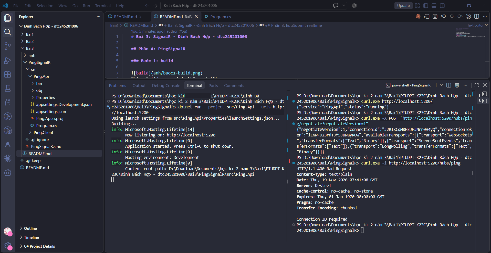
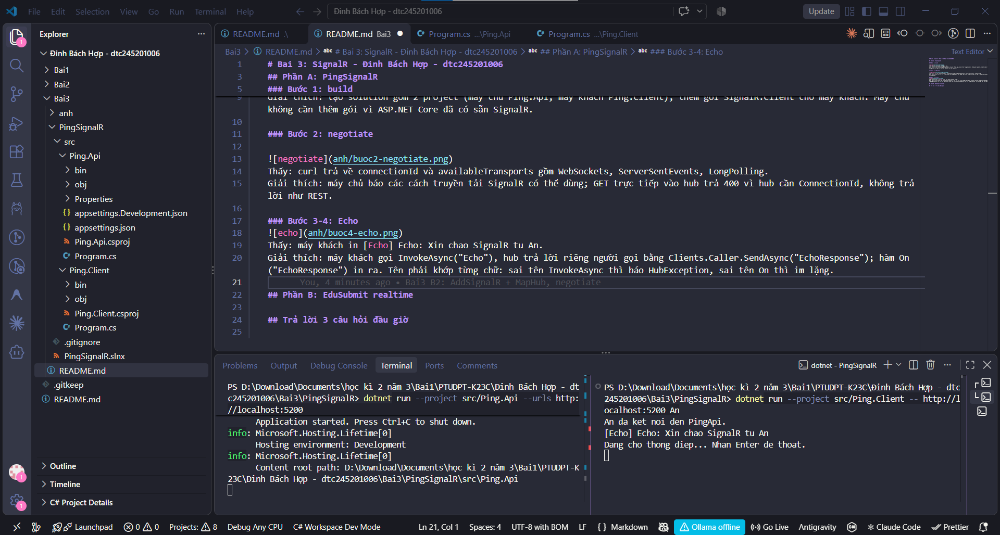

# Bai 3: SignalR - Đinh Bách Hợp - dtc245201006

## Phần A: PingSignalR

### Bước 1: build

Thấy: Build succeeded, không có lỗi.
Giải thích: tạo solution gồm 2 project (máy chủ Ping.Api, máy khách Ping.Client), thêm gói SignalR.Client cho máy khách. Máy chủ không cần thêm gói vì ASP.NET Core đã có sẵn SignalR.

### Bước 2: negotiate

Thấy: curl trả về connectionId và availableTransports gồm WebSockets, ServerSentEvents, LongPolling.
Giải thích: máy chủ báo các cách truyền tải SignalR có thể dùng; GET trực tiếp vào hub trả 400 vì hub cần ConnectionId, không trả lời như REST.

### Bước 3-4: Echo

Thấy: máy khách in [Echo] Echo: Xin chao SignalR tu An.
Giải thích: máy khách gọi InvokeAsync("Echo"), hub trả lời riêng người gọi bằng Clients.Caller.SendAsync("EchoResponse"); hàm On("EchoResponse") in ra. Tên phải khớp từng chữ: sai tên InvokeAsync thì báo HubException, sai tên On thì im lặng.

## Phần B: EduSubmit realtime

## Trả lời 3 câu hỏi đầu giờ
