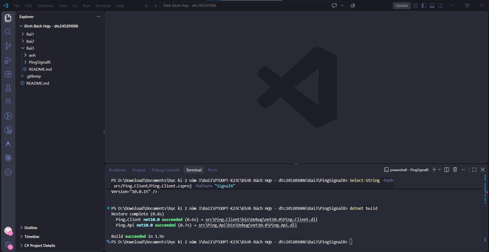
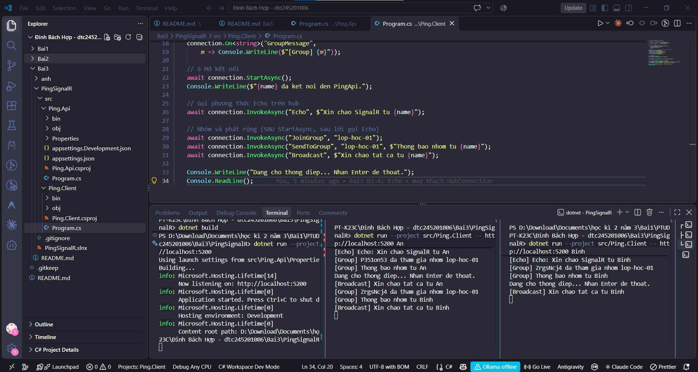
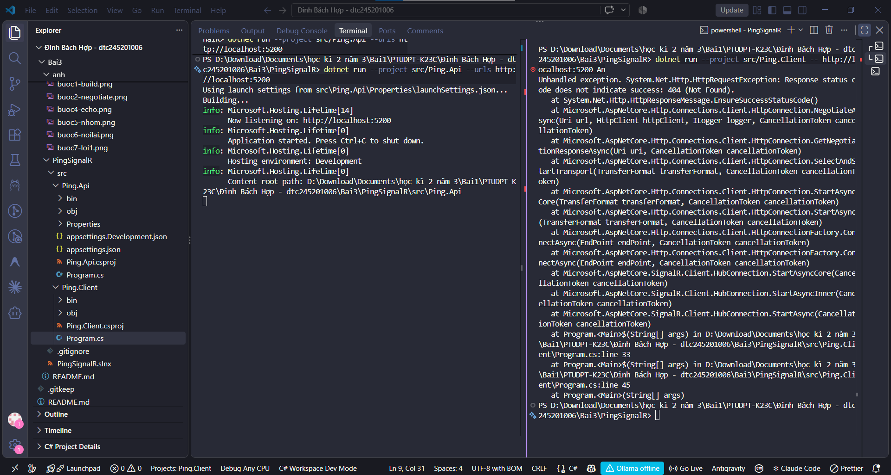

# Bai 3: SignalR - Đinh Bách Hợp - dtc245201006

## Phần A: PingSignalR

### Bước 1: build

Thấy: Build succeeded, không có lỗi.
Giải thích: tạo solution gồm 2 project (máy chủ Ping.Api, máy khách Ping.Client), thêm gói SignalR.Client cho máy khách. Máy chủ không cần thêm gói vì ASP.NET Core đã có sẵn SignalR.

### Bước 2: negotiate

Thấy: curl trả về connectionId và availableTransports gồm WebSockets, ServerSentEvents, LongPolling.
Giải thích: máy chủ báo các cách truyền tải SignalR có thể dùng; GET trực tiếp vào hub trả 400 vì hub cần ConnectionId, không trả lời như REST.

### Bước 3-4: Echo

Thấy: máy khách in [Echo] Echo: Xin chao SignalR tu An.
Giải thích: máy khách gọi InvokeAsync("Echo"), hub trả lời riêng người gọi bằng Clients.Caller.SendAsync("EchoResponse"); hàm On("EchoResponse") in ra. Tên phải khớp từng chữ: sai tên InvokeAsync thì báo HubException, sai tên On thì im lặng.

### Bước 5: Broadcast và Group

Thấy: An nhận [Group] và [Broadcast] của Bình nhưng không nhận [Echo] của Bình.
Giải thích: Echo dùng Clients.Caller nên chỉ gửi người gọi; JoinGroup/SendToGroup dùng Clients.Group nên chỉ thành viên nhóm lop-hoc-01 nhận; Broadcast dùng Clients.All nên mọi kết nối đều nhận, kể cả người gửi.

Thử thách (An, Bình trong nhóm; Chi không ở nhóm nào):

- An gọi Echo("hi"): chỉ An nhận.
- Chi gọi SendToGroup("lop-hoc-01","x"): An và Bình nhận, Chi không nhận vì không phải thành viên.
- Bình gọi Broadcast("y"): cả 3 người nhận.

### Bước 6: Vòng đời và tự nối lại

Thấy: tắt máy chủ thì máy khách in "Dang ket noi lai...", bật lại thì in "Da ket noi lai" với ConnectionId khác ban đầu.
Giải thích:

- ConnectionId đổi: máy chủ coi đây là kết nối MỚI.
- Nhóm bị mất: nhóm gắn với ConnectionId cũ, muốn ở lại nhóm phải gọi lại JoinGroup trong Reconnected.
- Tin gửi lúc rớt mất hẳn: SignalR không lưu tin chờ gửi lại.
- Lịch thử lại mặc định của WithAutomaticReconnect: 0s, 2s, 10s, 30s; hết 4 lần thì Closed.

### Bước 7: Ba thí nghiệm lỗi

#### Lỗi 1: Máy chủ chưa chạy

- Làm gì: tắt máy chủ rồi chạy máy khách.
- Thấy: máy khách dừng với HttpRequestException, không kết nối được tới localhost:5200.
- Giải thích: chưa có tiến trình nào lắng nghe cổng 5200. WithAutomaticReconnect chỉ cứu kết nối ĐÃ mở, không tự thử lại lần nối đầu tiên.

#### Lỗi 2: Sai đường dẫn hub

- Làm gì: sửa WithUrl thành /hub/ping (thiếu chữ s).
- Thấy: HttpRequestException với mã 404 (Not Found).
- Giải thích: lỗi xảy ra ở bước negotiate. Đường dẫn trong WithUrl phải khớp từng chữ với MapHub<PingHub>("/hubs/ping").

## Phần B: EduSubmit realtime

## Trả lời 3 câu hỏi đầu giờ
