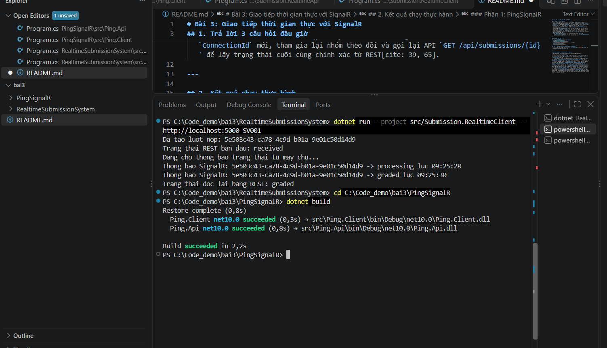
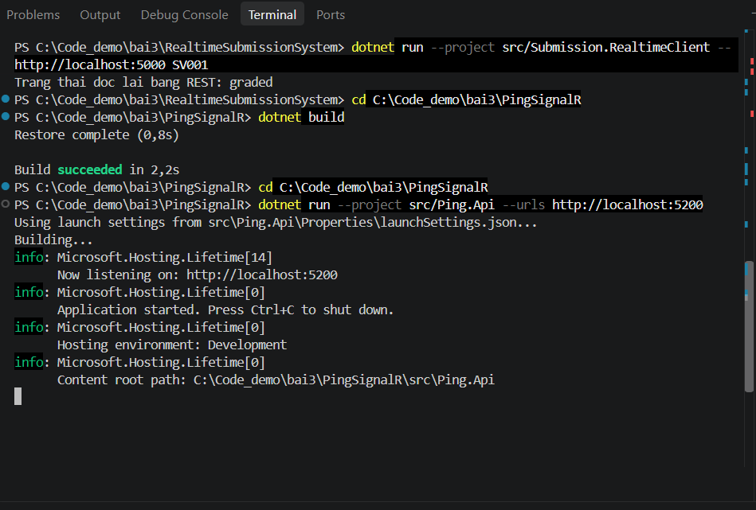
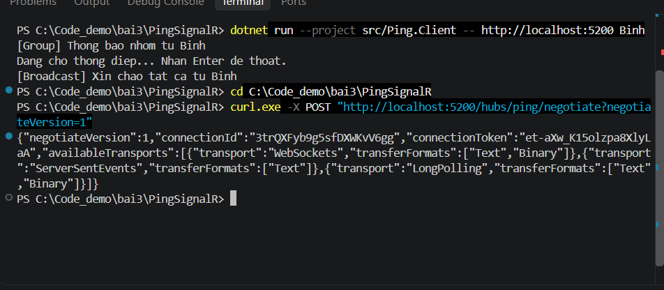
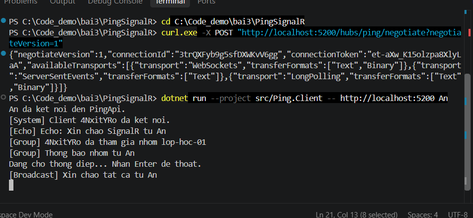
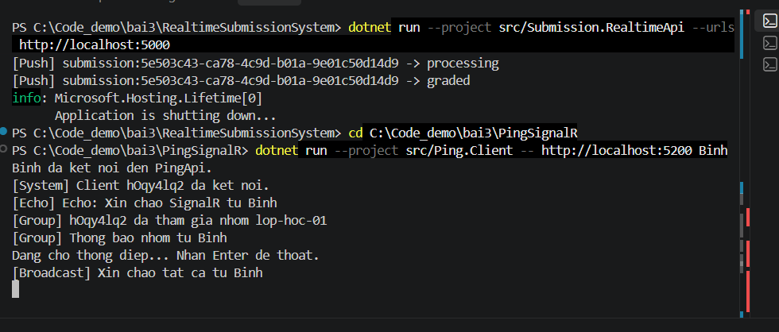
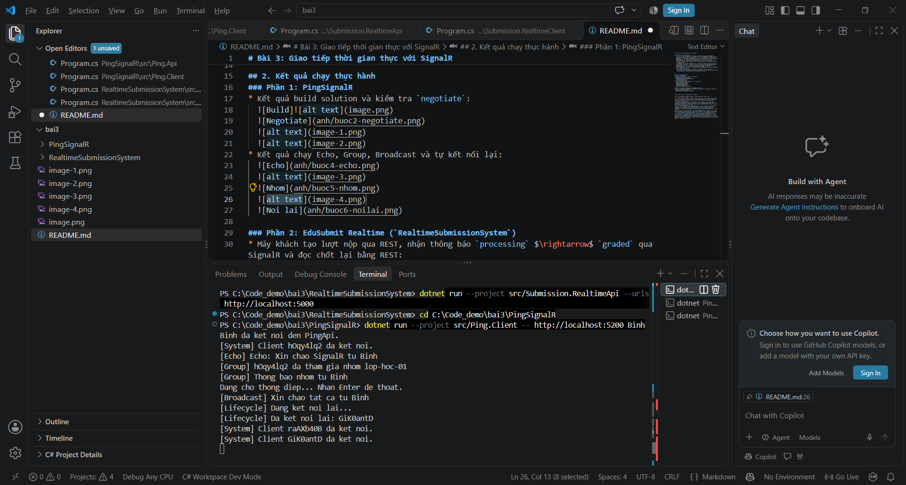
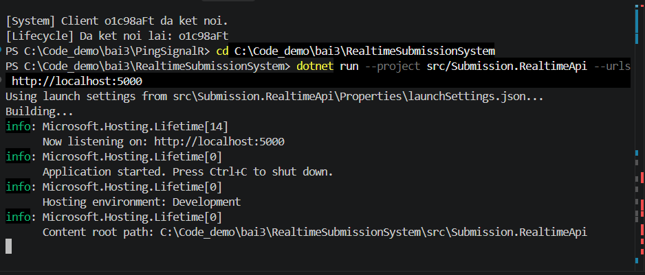
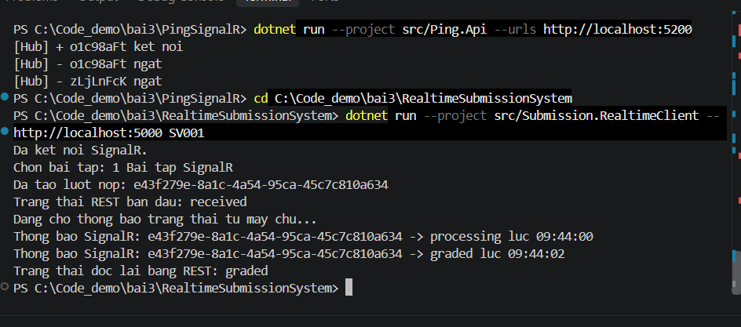

# Bài 3: Giao tiếp thời gian thực với SignalR

## 1. Trả lời 3 câu hỏi đầu giờ
1. **Máy chủ có thể chủ động báo cho máy khách mà không cần máy khách hỏi không?**
   * Có, khi máy khách mở sẵn một kết nối hai chiều lâu dài (WebSocket thông qua thư viện SignalR). Máy chủ đẩy thông điệp trực tiếp xuống thông qua `Clients.Group(...).SendAsync(...)` (hoặc dùng `IHubContext` nếu gửi từ tác vụ nền bên ngoài Hub).
2. **Đã có REST rồi, vì sao còn cần thêm SignalR? Hai thứ chia việc thế nào?**
   * **REST** chịu trách nhiệm tạo mới tài nguyên (`POST` trả về `201 Created`) và đọc trạng thái hiện tại (`GET` - đóng vai trò là nguồn sự thật) với các mã trạng thái HTTP rõ ràng.
   * **SignalR** chỉ đảm nhận việc đẩy tức thì các thay đổi trạng thái phát sinh sau yêu cầu ban đầu (`processing`, `graded`), giúp loại bỏ việc hỏi lặp lại (polling) gây tốn băng thông. SignalR bổ sung chứ không thay thế REST.
3. **Nếu đứt mạng đúng lúc máy chủ báo "đã chấm xong" (`graded`) thì sao?**
   * Thông điệp đẩy lúc đứt mạng sẽ bị mất hẳn vì SignalR không lưu trữ hàng đợi thông điệp để gửi lại.
   * `WithAutomaticReconnect()` giúp máy khách kết nối lại với một `ConnectionId` mới. Máy khách cần gọi lại `WatchSubmission` để tham gia nhóm theo dõi, đồng thời gọi API `GET /api/submissions/{id}` để lấy trạng thái hiện tại chính xác từ REST.

---

## 2. Kết quả chạy thực hành
### Phần 1: PingSignalR
* Kết quả build solution và kiểm tra `negotiate`:
  
  
  
* Kết quả chạy Echo, Group, Broadcast và tự kết nối lại:
  
  
  

### Phần 2: EduSubmit Realtime (`RealtimeSubmissionSystem`)
* Máy khách tạo lượt nộp qua REST, nhận thông báo `processing` $\rightarrow$ `graded` qua SignalR và đọc chốt lại bằng REST:
  
  
---

## 3. Bảng kết quả 5 thí nghiệm phân tán (Bước 7)

| STT | Tình huống thí nghiệm | Dự đoán | Kết quả chạy thật | Giải thích |
| :--- | :--- | :--- | :--- | :--- |
| 1 | Chạy 2 máy khách `SV001` và `SV002` cùng lúc | Mỗi máy chỉ nhận thông báo bài của mình | Đúng như dự đoán: `SV001` chỉ thấy tin của `SV001`, `SV002` chỉ thấy tin của `SV002` | Máy chủ phân tách người nhận theo nhóm riêng biệt `submission:{id}`. |
| 2 | Chạy máy khách khi máy chủ chưa bật | Lỗi không kết nối được | Ném ngoại lệ `HttpRequestException: Connection refused (localhost:5000)` | `WithAutomaticReconnect()` chỉ tự thử lại khi kết nối ban đầu đã mở thành công; lần nối đầu thất bại sẽ báo lỗi ngay. |
| 3 | Sửa sai đường dẫn hub thành `/hub/submissions` (thiếu `s`) | Lỗi 404 Not Found | Ném ngoại lệ `HttpRequestException: Response status code does not indicate success: 404 (Not Found)` | Lỗi xảy ra ngay ở bước bắt tay `negotiate` vì đường dẫn không khớp với `MapHub<SubmissionHub>("/hubs/submissions")`. |
| 4 | Sửa sai tên sự kiện lắng nghe thành `SubmissionStatusChange` (thiếu `d`) | Không nhận được thông báo | Chương trình không báo lỗi, im lặng chờ hết 10 giây và in: `Qua thoi gian cho thong bao graded.` | Sai tên thông điệp chiều từ máy chủ xuống máy khách (`SendAsync` lệch `On`) sẽ bị bỏ qua trong im lặng. |
| 5 | Chờ 4 giây (`Task.Delay(4000)`) rồi mới gọi `WatchSubmission` | Lỡ mất thông báo đẩy từ SignalR | Không nhận được dòng `Thong bao SignalR` nào, nhưng dòng cuối đọc lại bằng REST vẫn in `graded` | Quá trình chấm mất 3 giây; vào nhóm muộn sau 4 giây nên lỡ tin đẩy. Nhờ gọi lại REST ở bước cuối nên vẫn lấy đúng trạng thái thật. |