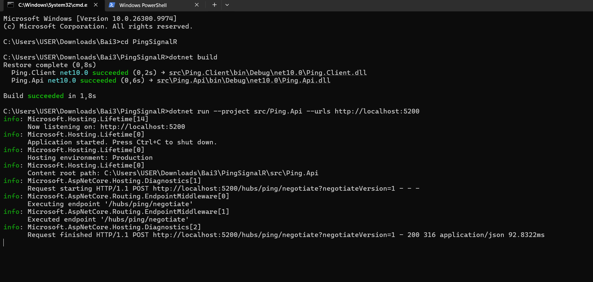
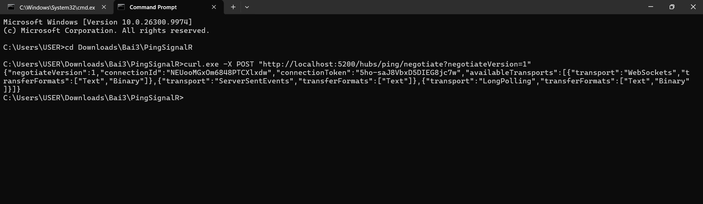
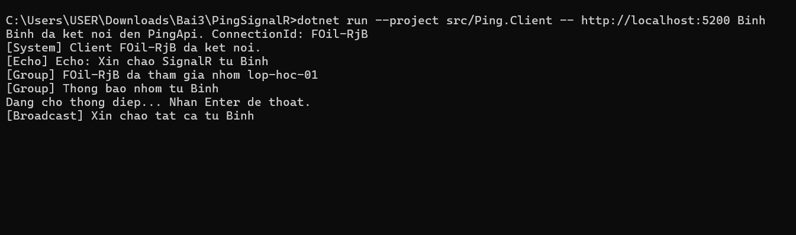
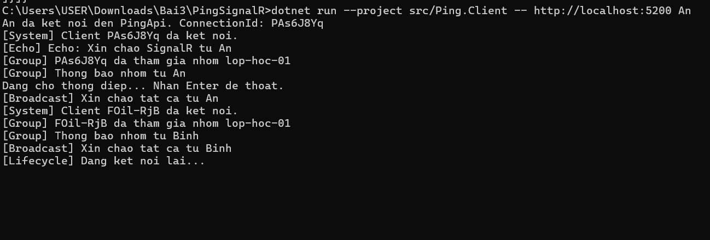
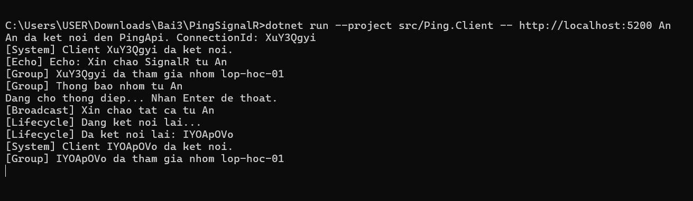

# Bài 3: Giao tiếp thời gian thực với SignalR

Họ tên: Đặng Hoàng Anh  MSSV: dtc245200360
## Cấu trúc
- `PingSignalR/` – hub Echo / Broadcast / Group / vòng đời (cổng 5200)
- `RealtimeSubmissionSystem/` – REST (Bài 2) + hub `/hubs/submissions` (cổng 5000)

## Cách chạy
```powershell
# PingSignalR
cd PingSignalR
dotnet run --project src/Ping.Api --urls http://localhost:5200
dotnet run --project src/Ping.Client -- http://localhost:5200 An      # terminal 2
dotnet run --project src/Ping.Client -- http://localhost:5200 Binh    # terminal 3

# EduSubmit realtime
cd RealtimeSubmissionSystem
dotnet run --project src/Submission.RealtimeApi --urls http://localhost:5000
dotnet run --project src/Submission.RealtimeClient -- http://localhost:5000 SV001
```

## Bước 1: build

Thấy: Build succeeded, 0 Error(s).
Giải thích: 2 project (máy chủ, máy khách) build được; gói SignalR.Client chỉ cần ở máy khách vì máy chủ đã có SignalR trong Microsoft.AspNetCore.App.

## Bước 2: negotiate

Thấy: curl trả về connectionId và availableTransports (WebSockets, ServerSentEvents, LongPolling).
Giải thích: máy chủ báo các cách truyền tải; SignalR ưu tiên WebSocket, rồi SSE, rồi Long Polling.

## Bước 3–4: Echo

Thấy: `[Echo] Echo: Xin chao SignalR tu An`.
Giải thích: InvokeAsync("Echo") gọi hub; hub gửi "EchoResponse" bằng Clients.Caller; hàm On đã đăng ký in ra.

## Bước 5: Broadcast và Group

Thấy: An nhận [Group] và [Broadcast] của Bình nhưng không có [Echo] của Bình.
Giải thích: Echo dùng Clients.Caller (chỉ người gọi); Group chỉ thành viên nhóm; All là mọi kết nối.

## Bước 6: vòng đời và nối lại

Thấy: `Dang ket noi lai...` rồi `Da ket noi lai`, ConnectionId đổi.
Giải thích: nhóm gắn với ConnectionId cũ nên phải JoinGroup lại trong Reconnected; tin gửi lúc rớt bị mất.

## Bước 7: ba lỗi cố ý (PingSignalR)
| # | Làm gì | Thấy gì | Giải thích |
|---|--------|---------|-----------|
| 1 | Chạy máy khách khi máy chủ tắt | HttpRequestException: Connection refused | StartAsync ném lỗi ngay; WithAutomaticReconnect chỉ cứu kết nối ĐÃ mở |
| 2 | WithUrl `/hub/ping` | 404 Not Found | Lỗi ở negotiate; đường dẫn phải khớp MapHub |
| 3 | On("EchoRespone") | Không lỗi, không có dòng [Echo] | Sai tên chiều xuống thì im lặng |

(ảnh: `anh/buoc7-loi1.png` … `anh/buoc7-loi3.png`)

## EduSubmit realtime

Kết quả máy khách:
```
Da ket noi SignalR.
Chon bai tap: 1 - Bai tap SignalR
Da tao luot nop: xxxxxxxx-...
Trang thai REST ban dau: received
Dang cho thong bao trang thai tu may chu...
Thong bao SignalR: xxxxxxxx-... -> processing luc hh:mm:ss
Thong bao SignalR: xxxxxxxx-... -> graded luc hh:mm:ss
Trang thai doc lai bang REST: graded
```
Ảnh `anh/edusubmit-requests.png`: kết quả requests.http (200, 201, 400, 404).

## 3 câu hỏi đầu giờ
1. **Máy chủ có thể chủ động báo cho máy khách không?** Có, nếu máy khách mở sẵn một kết nối lâu dài (WebSocket qua SignalR). Máy chủ gửi bằng `Clients.Group(...).SendAsync`, và dùng `IHubContext` khi ở ngoài hub.
2. **REST và SignalR chia việc thế nào?** REST tạo và đọc tài nguyên với mã trạng thái rõ ràng (là nguồn sự thật). SignalR đẩy các thay đổi phát sinh sau yêu cầu ban đầu. SignalR không thay thế REST.
3. **Đứt mạng đúng lúc báo graded?** Tin đó mất vì SignalR không lưu tin. `WithAutomaticReconnect` nối lại với ConnectionId mới; máy khách Watch lại nhóm và gọi `GET /api/submissions/{id}` để lấy trạng thái cuối.

## 5 thí nghiệm EduSubmit (Bước 7)

**Mục tiêu:** Kiểm tra cơ chế nhận thông báo thời gian thực của SignalR, xử lý lỗi kết nối, kiểm tra tên sự kiện và sự phối hợp giữa REST với SignalR.

| # | Thí nghiệm | Dự đoán (tự điền trước khi chạy) | Kết quả tham khảo | Giải thích |
|---|---|---|---|---|
| 1 | Chạy đồng thời 2 máy khách SV001 và SV002 | Mỗi máy khách chỉ nhận thông báo liên quan đến lượt nộp của mình. | SV001 chỉ thấy thông báo của lượt nộp SV001; SV002 chỉ thấy thông báo của lượt nộp SV002. | Mỗi lượt nộp được đưa vào một Group riêng theo ID (`submission:{id}`). |
| 2 | Tắt máy chủ rồi chạy máy khách | Máy khách không thể kết nối đến máy chủ. | `HttpRequestException: Connection refused (localhost:5000)`. | `StartAsync()` thất bại khi kết nối lần đầu. `WithAutomaticReconnect()` không tự xử lý lỗi kết nối ban đầu. |
| 3 | Đổi `WithUrl` thành `/hub/submissions` | Máy khách không thể tìm thấy Hub do sử dụng sai đường dẫn. | `HttpRequestException: 404 (Not Found)`. | Đường dẫn đúng của Hub là `/hubs/submissions`, có chữ `s` sau `hub`. |
| 4 | Đổi `On<SubmissionStatusMessage>("SubmissionStatusChanged")` thành `On<SubmissionStatusMessage>("SubmissionStatusChange")` | Kết nối vẫn thành công nhưng máy khách không nhận được thông báo trạng thái. | Không có lỗi kết nối. Sau 10 giây xuất hiện: `Qua thoi gian cho thong bao graded.` | Tên sự kiện đăng ký ở máy khách không trùng với tên sự kiện máy chủ gửi nên callback không được thực thi. |
| 5 | Thêm `await Task.Delay(4000);` ngay trước `await connection.InvokeAsync("WatchSubmission", ...)` | Máy khách có thể bỏ lỡ thông báo nếu máy chủ đã gửi thông báo trước khi máy khách tham gia Group. | Không nhận được thông báo SignalR; REST đọc lại trả về trạng thái `graded`. | Máy khách tham gia Group muộn nên bỏ lỡ thông báo đã gửi. SignalR không lưu lịch sử thông báo. REST vẫn là nguồn dữ liệu chính xác để lấy trạng thái hiện tại. |

**Nhận xét sau 5 thí nghiệm:**

1. SignalR Group giúp phân phối thông báo đúng đối tượng theo từng lượt nộp.
2. `WithAutomaticReconnect()` không thay thế việc xử lý lỗi kết nối lần đầu.
3. Đường dẫn Hub ở máy khách phải khớp với đường dẫn `MapHub` ở máy chủ.
4. Tên sự kiện giữa máy chủ và máy khách phải giống nhau hoàn toàn.
5. SignalR phù hợp để thông báo thay đổi tức thời, còn REST được sử dụng để truy vấn và xác nhận trạng thái hiện tại.

**Kết luận:** Qua 5 thí nghiệm, có thể thấy SignalR hỗ trợ giao tiếp thời gian thực hiệu quả nhưng không đảm bảo lưu trữ và phát lại các thông báo đã bỏ lỡ. Vì vậy, cần kết hợp SignalR với REST để hệ thống vừa có khả năng cập nhật tức thời, vừa đảm bảo lấy được trạng thái chính xác của lượt nộp.
> Lưu ý: điền cột "Dự đoán" bằng suy nghĩ của chính em TRƯỚC khi chạy, rồi mới đối chiếu.

## Bài tập nâng cao đã làm: trạng thái `failed`
Máy chủ: `repositoryUrl` không bắt đầu bằng `https://` thì trạng thái cuối là `failed`. Máy khách in cảnh báo màu đỏ khi nhận `failed`.
