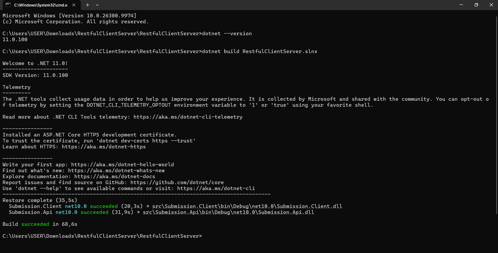

# Bài 2 – RESTful API: EduSubmit

Họ tên: Đặng Hoàng Anh  MSSV: DTC245200360

Hệ thống nộp bài gồm hai chương trình (hai tiến trình) nói chuyện với nhau qua HTTP + JSON:

- `src/Submission.Api`: máy chủ Minimal API, cổng **5000**, dữ liệu lưu trong bộ nhớ (`List<>`).
- `src/Submission.Client`: máy khách console dùng `HttpClient`.

## 1. Hợp đồng API

| Phương thức | URI | Thành công | Lỗi có thể gặp |
|---|---|---|---|
| GET | `/api/assignments` | 200 + danh sách | – |
| GET | `/api/assignments/{assignmentId}` | 200 + một bài tập | 404 `ASSIGNMENT_NOT_FOUND` |
| POST | `/api/assignments/{assignmentId}/submissions` | 201 + `Location` + lượt nộp | 404 `ASSIGNMENT_NOT_FOUND`, 400 `ASSIGNMENT_CLOSED`, 400 `INVALID_SUBMISSION` |
| GET | `/api/submissions/{submissionId}` | 200 + một lượt nộp | 404 `SUBMISSION_NOT_FOUND` |

Mọi lỗi do handler trả đều cùng dạng `{ "code": "...", "message": "..." }` (`ApiError`).

Thứ tự kiểm tra trong handler `POST`: bài tập có tồn tại → bài tập còn mở → dữ liệu hợp lệ → tạo lượt nộp (máy chủ tự sinh `Id`, `Status = "received"`, `ReceivedAt`).

## 2. Các lệnh đã chạy

```powershell
mkdir RestfulClientServer ; cd RestfulClientServer
dotnet new sln -n RestfulClientServer
dotnet new web -n Submission.Api -o src/Submission.Api
dotnet new console -n Submission.Client -o src/Submission.Client
dotnet sln add src/Submission.Api/Submission.Api.csproj
dotnet sln add src/Submission.Client/Submission.Client.csproj
dotnet new gitignore
dotnet build

# Terminal 1: máy chủ
dotnet run --project src/Submission.Api --urls http://localhost:5000

# Terminal 2: máy khách
dotnet run --project src/Submission.Client -- http://localhost:5000
```

### Ảnh kết quả

**`dotnet build`**



**Máy khách in đủ 4 nấc**: liệt kê bài tập đang mở → nộp bài (201) → đọc lại theo header `Location` (200) → cố ý gửi dữ liệu sai (400 `INVALID_SUBMISSION`).


**`requests.http`** (VS Code + REST Client):

| Yêu cầu | Kết quả | Ảnh |
|---|---|---|
| 1. `GET /` | 200 |  |
| 2. `GET /api/assignments` | 200 |  |
| 3. `GET /api/assignments/1` | 200 |  |
| 4. `GET /api/assignments/999` | 404 `ASSIGNMENT_NOT_FOUND` |  |
| 5. `POST` bài 1 | 201 + `Location` |  |
| 6. `GET` lượt nộp vừa tạo | 200 |  |
| 7. `POST` dữ liệu rỗng | 400 `INVALID_SUBMISSION` |  |
| 8. `POST` bài 999 | 404 `ASSIGNMENT_NOT_FOUND` |  |
| 9. `POST` bài 3 (đã đóng) | 400 `ASSIGNMENT_CLOSED` |  |
| 11. Thiếu `Content-Type` | 400, body rỗng |  |
| 12. JSON sai cú pháp | 400, body rỗng |  |
| 13. Thiếu `repositoryUrl` | 400 `INVALID_SUBMISSION` |  |
| 14. `PUT /api/assignments/1` | 405, `Allow: GET` |  |

## 3. Bảng phá thử (bước 5)

Gửi bằng `curl.exe -i -X POST http://localhost:5000/api/assignments/1/submissions -H "Content-Type: application/json" -d "@sv001.json"` (đổi tệp/URI theo từng ca).

| Ca | Yêu cầu | Mã mong đợi | Ai trả | Kết quả thật |
|---|---|---|---|---|
| 5a | POST bài 1, `sv001.json` | 201 + Location | Handler | **201 Created**, `Location: /api/submissions/785ea995-b31a-44cc-bc32-b39984ba1192`, body có `status: "received"` |
| 5b | POST bài 1, `rong.json` | 400 `INVALID_SUBMISSION` | Handler | **400**, `{"code":"INVALID_SUBMISSION","message":"Thieu ma sinh vien hoac link ma nguon."}` |
| 5c | POST bài 999, `sv001.json` | 404 `ASSIGNMENT_NOT_FOUND` | Handler | **404**, `{"code":"ASSIGNMENT_NOT_FOUND","message":"Khong tim thay bai tap."}` |
| 5d | Bỏ header Content-Type | 415, body rỗng | Framework | **400 Bad Request**, `Content-Length: 0` (body rỗng, không có `ApiError`) |
| 5e | Body JSON hỏng | 400, body là văn bản | Framework | **400 Bad Request**, `Content-Length: 0` (body rỗng, không có `ApiError`) |
| 5f | Body thiếu `repositoryUrl` (`thieu-repo.json`) | 400 `INVALID_SUBMISSION` | Handler | **400**, `{"code":"INVALID_SUBMISSION",...}` |
| 5g | `PUT /api/assignments/1` | 405, `Allow: GET` | Framework | **405 Method Not Allowed**, `Allow: GET`, body rỗng |
| 5h | POST bài 3 (đã đóng) | 400 `ASSIGNMENT_CLOSED` | Handler | **400**, `{"code":"ASSIGNMENT_CLOSED","message":"Bai tap da dong, khong nhan them bai nop."}` |

**Nhận xét từ bảng:**

- Các ca **handler** trả (5a, 5b, 5c, 5f, 5h) đều có body `ApiError` dạng JSON `{code, message}`, nên client đọc lỗi bằng một hàm chung (`PrintApiErrorAsync`).
- Các ca **framework** trả (5d, 5e, 5g) không đi qua handler nên **không có `ApiError`**: body rỗng (hoặc chỉ có header như `Allow`). Vì vậy client phải xử lý được trường hợp không đọc được `ApiError` (khối `catch` trong `PrintApiErrorAsync`).
- Ở ca 5d và 5e, kết quả quan sát được là 400 với body rỗng. Riêng 5d khác với mã 415 dự kiến ban đầu; kết quả này ghi lại đúng theo ảnh chụp từ REST Client, và có thể thay đổi theo phiên bản .NET hoặc theo công cụ gửi yêu cầu. Cần chạy lại bằng `curl.exe -i` (không có `-H "Content-Type: ..."`) nếu muốn đối chiếu.
- Ca 5f cho thấy dữ liệu thiếu trường vẫn vào được handler (trường thiếu thành `null`) rồi bị cổng kiểm tra "dữ liệu hợp lệ" chặn lại bằng `INVALID_SUBMISSION`.

> Trong code mẫu, bài tập 3 được tạo sẵn với `IsOpen = false` để làm ca 5h.

## 4. Ba câu hỏi giải thích

**1. Vì sao URI dùng danh từ, còn hành động do phương thức HTTP đảm nhận?**
URI chỉ *tài nguyên* (`assignments`, `submissions`), tức là "thứ" mà API quản lý. Hành động đã được biểu diễn bằng phương thức HTTP: GET để đọc, POST để tạo, PUT để thay thế, DELETE để xóa. Nhờ vậy cùng một URI có thể dùng cho nhiều thao tác và client đoán được cách dùng chỉ từ URI + phương thức. Ví dụ `POST /api/assignments/1/submissions` ("tạo lượt nộp cho bài tập 1") rõ nghĩa hơn `POST /submitAssignment`, vì loại bỏ động từ trong URI và cho thấy quan hệ cha–con.

**2. "Stateless" thể hiện ở đâu trong code đã viết?**
Mỗi yêu cầu tự mang đủ thông tin: `assignmentId` nằm trên URI, `studentCode` và `repositoryUrl` nằm trong body. Handler `MapPost` chỉ dùng các tham số của yêu cầu đó, không dựa vào việc "lần trước client đã chọn bài tập nào" (không có session). Vì vậy yêu cầu nào tới bản server nào cũng xử lý được. Stateless không có nghĩa server không lưu dữ liệu: danh sách `submissions` vẫn được lưu, chỉ là server không nhớ cuộc hội thoại giữa hai yêu cầu.

**3. Vì sao client và server mỗi bên khai báo DTO riêng mà vẫn khớp nhau?**
Hai chương trình chạy ở hai tiến trình, không chung bộ nhớ và không tham chiếu project của nhau. Thứ duy nhất đi qua mạng là chuỗi JSON. DTO chỉ là bản "khuôn" để đọc/ghi JSON, nên hai bên khớp nhau nhờ cùng *tên trường và kiểu dữ liệu trong JSON* (hợp đồng API). Nếu đặt sai tên (ví dụ `Ten` thay vì `Name`), trình biên dịch không báo lỗi nhưng giá trị sẽ là `null`, vì hợp đồng chỉ là lời hứa giữa hai bên.
